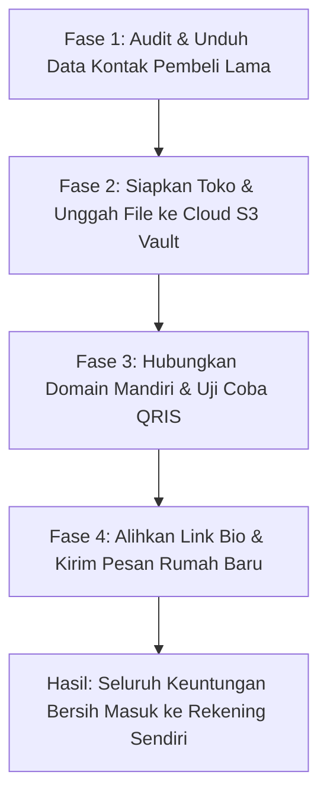
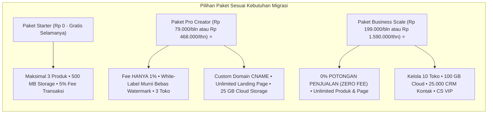

Momen ketika Anda menyadari bahwa platform sewa pihak ketiga menyedot jutaan rupiah dari komisi transaksi Anda adalah titik balik yang mencerahkan. 

Namun di detik yang sama, biasanya muncul rasa cemas dan ragu:
- *"Gimana kalau pas saya ganti link toko, calon pembeli malah bingung?"*
- *"Gimana cara mindahin file e-book, video, dan template tanpa mengganggu pembeli yang sudah terlanjur order?"*
- *"Bikin website toko sendiri bukannya harus ngerti coding atau bayar web programmer jutaan rupiah?"*

Kabar baiknya: **migrasi ke platform [SitusBisnis](https://situsbisnis.com) di era sekarang bisa diselesaikan dalam waktu kurang dari 30 menit tanpa perlu menyentuh satu baris kode pun**.

Artikel ini memandu Anda langkah demi langkah (*step-by-step*) memindahkan operasional penjualan produk digital Anda dari platform sewa seperti Lynk.id, Mayar, atau marketplace lain langsung ke **[SitusBisnis](https://situsbisnis.com)**—dengan aman, mulus, dan langsung menghemat jutaan rupiah komisi sejak hari pertama.

---

## Fase 1: Mengamankan Aset dan Riwayat Pembeli Lama

Sebelum Anda mengubah tautan di media sosial, langkah pertama yang wajib dilakukan adalah mengamankan data transaksi yang ada di platform lama:

1. **Ekspor Riwayat Pesanan:** Masuk ke dashboard platform lama Anda (misal dashboard Lynk.id atau marketplace), cari menu riwayat transaksi, lalu unduh berkas CSV atau spreadsheet data pembeli Anda.
2. **Kumpulkan Daftar Kontak WhatsApp:** Salin nama dan nomor WhatsApp pembeli lama yang pernah bertransaksi. Daftar ini adalah aset emas Anda untuk kampanye peluncuran "rumah baru".
3. **Kompilasi Berkas Master Produk:** Pastikan berkas materi digital Anda (PDF, dokumen ZIP, lembar kerja spreadsheet, atau link video rekaman) tersimpan rapi di komputer lokal Anda dengan penamaan versi terbaru.

---

## Fase 2: Menyiapkan Etalase Penjualan di SitusBisnis

Buka **[SitusBisnis.com](https://situsbisnis.com)** dan lakukan pendaftaran akun baru:

### Langkah Konfigurasi:
1. **Tentukan Nama Toko dan Subdomain:**
   Saat mendaftar, Anda langsung mendapatkan subdomain toko gratis berformat `namabisnis.sibi.my.id`.
2. **Unggah Produk Digital ke Cloud S3 Vault:**
   - Masuk ke menu **Produk** > **Tambah Produk Baru**.
   - Masukkan judul produk yang menarik, deskripsi manfaat, harga jual, dan gambar sampul (*cover*).
   - Unggah berkas digital Anda ke brankas penyimpanan terenkripsi Cloud S3 Vault bawaan SitusBisnis (500 MB di paket Starter, 25 GB di Pro Creator, atau 100 GB di Business Scale).
3. **Atur Akses Pengiriman Berkas Otomatis:**
   Pastikan opsi pengiriman otomatis aktif. Begitu pembeli membayar, sistem akan mengalihkan layar mereka ke tombol unduh berbatas waktu (*expiring link*) sekaligus mengirimkan tanda terima resmi ke WhatsApp pembeli.

---

## Fase 3: Menghubungkan Custom Domain Sendiri (Khusus Paket Basic ke Atas)

Jika Anda menggunakan paket **Pro Creator** atau **Business Scale**, Anda bisa menghubungkan domain pribadi Anda sendiri (misal `toko.namabrandanda.com` atau `katalog.namasitus.id`) agar toko terlihat 100% independen dan profesional:

1. Buka pengaturan domain di penyedia domain Anda (seperti Niagahoster, DomaiNesia, IDwebhost, atau Cloudflare).
2. Tambahkan satu baris data **CNAME Record**:
   - Host/Name: `toko` (atau subdomain pilihan Anda)
   - Value/Target: Arahkan ke target CNAME resmi yang tertera di dashboard SitusBisnis Anda.
3. Simpan perubahan. Dalam beberapa menit, toko online Anda sudah aktif di alamat domain Anda sendiri dengan sertifikat keamanan SSL gratis (*HTTPS*).

---

## Fase 4: Pengalihan Tautan dan Pengumuman Etis ke Pembeli Lama

Kini etalase toko mandiri Anda sudah siap menerima pesanan. Langkah terakhir adalah mengalihkan arus trafik tanpa membuat pembeli bingung:

### 1. Ganti Tautan di Profil Media Sosial
Perbarui link di bio Instagram, bio TikTok, deskripsi saluran YouTube, dan link channel Telegram Anda:
- Dari: `lynk.id/namakreator` (atau link marketplace lama)
- Menjadi: `toko.namabrandanda.com` (atau `namakreator.sibi.my.id`)

### 2. Pasang Pesan Transisi di Lapak Lama (Jika Masih Aktif)
Jangan langsung menghapus produk di lapak lama seketika. Berikan pengumuman transisi di deskripsi produk lama Anda:
> *"PENTING: Seluruh materi e-book & template ini telah dipindahkan ke etalase toko resmi mandiri kami di [toko.namabrandanda.com] dengan penambahan bonus modul terbaru dan checkout QRIS otomatis yang lebih cepat."*

### 3. Sapa Pelanggan Lama Lewat WhatsApp dengan Penawaran Spesial
Gunakan daftar kontak pembeli lama yang sudah Anda ekspor di Fase 1 untuk mengirimkan pesan ramah:

> *"Halo Kak [Nama Pembeli], terima kasih ya sudah pernah mengoleksi panduan digital kami sebelumnya. Sekadar info gembira, per hari ini kami resmi membuka rumah baru di [toko.namabrandanda.com].*
> 
> *Khusus untuk pembeli setia seperti Kakak, kami menyiapkan voucher diskon 25% (Kode: RUMAHBARU) untuk produk terbaru kami. Tautannya bisa langsung diakses dengan pembayaran QRIS instan di sini ya Kak. Terima kasih banyak atas dukungannya!"*

---

## Tabel Hasil Finansial Pasca Migrasi: Sebelum vs. Sesudah Pindah

Berikut adalah realitas metrik yang dialami kreator setelah bermigrasi ke SitusBisnis:

| Parameter Evaluasi | Sebelum Pindah (Platform Pihak Ketiga) | Sesudah Pindah ([SitusBisnis Pro Creator](https://situsbisnis.com)) | Dampak Langsung |
| :--- | :--- | :--- | :--- |
| **Potongan Komisi per Transaksi** | 3% hingga 10% dipotong terus-menerus | **Hanya 1%** *(atau 0% di Business Scale)* | Laba bersih per pesanan naik signifikan |
| **Biaya Tarik Saldo (Payout)** | Rp 5.000 per penarikan | **Hanya Rp 4.000 / Rp 3.000** | Lebih hemat |
| **Pengalaman Checkout Pembeli** | Kartu bio generik / form rumit | **Halaman profesional + QRIS dinamis 10 detik** | Angka drop-off checkout menurun drastis |
| **Kepemilikan Data Pelanggan** | Data nomor WA disamarkan platform | **100% Tersimpan di Database CRM Anda** | Siap dijual ulang (*repeat order*) kapan saja |
| **Branding Toko** | Ada watermark & rekomendasi produk lain | **White-Label Murni Bebas Iklan Kompetitor** | Kredibilitas brand Anda meningkat 3x lipat |

---

## Ambil Kendali Penuh Atas Penjualan Digital Anda di SitusBisnis

Bisnis digital yang sehat dibangun di atas fondasi yang kokoh: margin laba yang terlindungi dan kepemilikan penuh atas hubungan dengan para pembeli Anda.

Jangan biarkan hasil kerja keras Anda terus-menerus tergerus oleh potongan komisi pihak ketiga yang tidak perlu. 

Mulai langkah migrasi Anda hari ini. Buka akun Anda secara gratis di **[SitusBisnis.com](https://situsbisnis.com)** dan rasakan kemudahan mengelola produk digital dengan kendali dan keuntungan penuh milik Anda sendiri.
