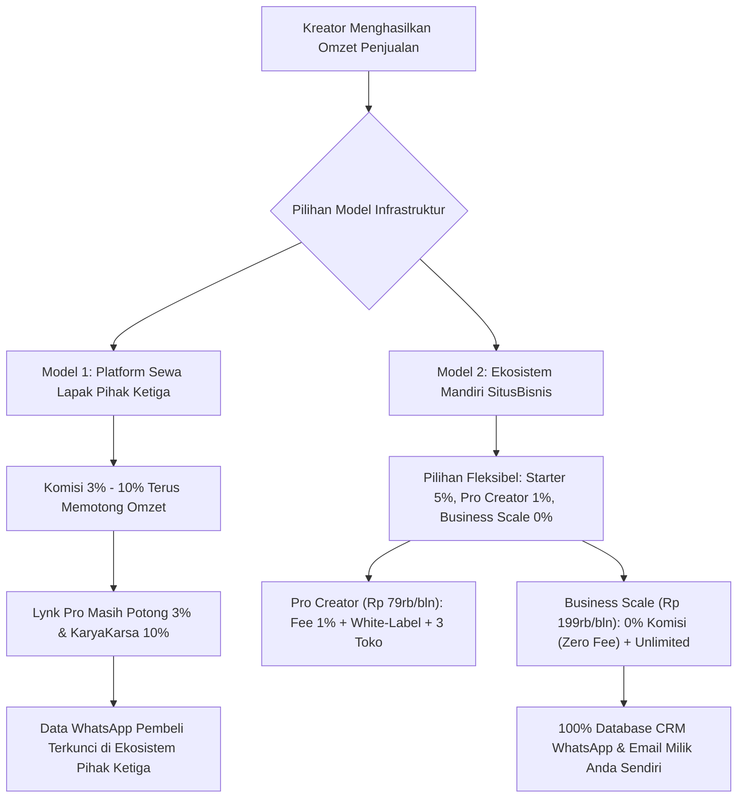
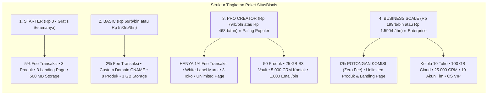
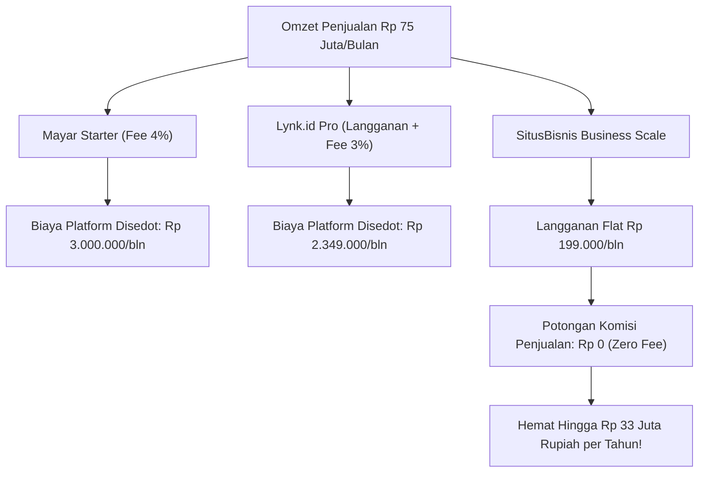

Bagi siapa pun yang menjual produk digital di Indonesia—mulai dari e-book panduan, template lembar kerja, rekaman workshop, kelas online (*LMS*), penawaran jasa, hingga produk fisik—pertanyaan pertama yang selalu muncul di benak adalah:

*"Enaknya pakai platform apa ya biar transaksi otomatis, biayanya hemat, dan gak bikin repot?"*

Banyak pemula langsung tergiur mendaftar ke platform yang sering wira-wiri di bio Instagram atau TikTok para konten kreator. Di awal, semuanya terasa serba instan: tinggal daftar, unggah file, pasang tautan di profil, lalu tunggu orang membeli.

Namun, begitu produk Anda mulai laku keras dan angka penjualan tembus puluhan hingga ratusan pesanan setiap bulan, sebuah kenyataan pahit baru disadari: **potongan komisi transaksi platform dan biaya penarikan saldo pelan-pelan menyedot jutaan rupiah dari kantong Anda.**

Bukan hanya masalah uang, ada risiko bisnis yang jauh lebih krusial: **kebanyakan platform menyamarkan nomor WhatsApp dan email pembeli**, sehingga Anda tidak bisa menyapa atau menjual produk baru ke pembeli lama Anda sendiri.

Artikel ini menyajikan riset objektif dan komparasi mendalam antara platform populer di Indonesia—seperti **Lynk.id, Mayar.id, KaryaKarsa, Tribelio**—serta membedah struktur berjenjang dari **[SitusBisnis](https://situsbisnis.com)** secara akurat dan transparan berdasarkan data resmi.

---

## 1. Anatomi dan Bedah Biaya Platform Penjualan Digital di Indonesia

Mari kita bedah struktur biaya, model langganan, serta titik gesek (*friction points*) dari masing-masing platform berdasarkan data operasional terbaru.

### A. Lynk.id (Platform Link-in-Bio & Creator Storefront)
Lynk.id sangat digemari kreator media sosial karena formatnya yang ringkas seperti kartu di layar ponsel pintar.

* **Skema Biaya & Komisi:**
  - **Akun Gratis (Free):** Dikenakan potongan biaya layanan sebesar **5%** dari setiap transaksi penjualan.
  - **Akun Pro:** Biaya langganan sekitar **Rp 99.000 per bulan**, namun transaksi penjualan **tetap dikenakan potongan komisi 3%**.
  - **Biaya Penarikan Saldo (Payout):** Dikenakan biaya admin bank sebesar **Rp 5.000** per penarikan.
* **Kelebihan:** Sangat cepat untuk pemula yang belum memiliki situs sendiri, katalog produk rapi di bio media sosial, dan mendukung pembayaran QRIS.
* **Titik Gesek:**
  - Bahkan setelah Anda membayar biaya langganan Pro Rp 99.000/bulan, Lynk.id **masih memotong 3%** dari setiap transaksi. Jika omzet Anda Rp 30 juta, Anda tetap dipotong Rp 900.000 per bulan.
  - Tampilan berformat kartu *link-in-bio* generik kurang mencerminkan otoritas profesional bagi konsultan, agensi, kursus berbayar, atau penjual materi bernilai tinggi (*high-ticket*).

### B. Mayar.id (Platform Fintech Checkout & Payment Link)
Mayar memposisikan dirinya sebagai infrastruktur *fintech checkout* untuk berbagai jenis pembayaran—mulai dari unduhan file digital, tiket webinar, hingga invoice B2B.

* **Skema Biaya & Komisi:**
  - **Platform Fee Produk Digital:** Paket Starter mengenakan biaya platform **4%** untuk produk digital (e-book, audio, modul, kelas online). Pada paket Business, fee platform turun menjadi **3%**.
  - **Payment Gateway Fee Tambahan:** Di luar biaya platform di atas, ada biaya jalur pembayaran (QRIS 0.7%, Virtual Account bank sekitar Rp 4.000 per transaksi, serta e-wallet 1.5% - 2%).
  - **Pajak PPN:** Dikenakan pada biaya transaksi sesuai regulasi perbankan.
* **Kelebihan:** Metode pembayaran sangat lengkap (VA multi-bank, e-wallet, kartu kredit, paylater), mendukung faktur pajak B2B, dan fitur membership berulang.
* **Titik Gesek:**
  - Akumulasi biaya platform (3-4%) + biaya jalur pembayaran + PPN membuat total potongan riil per transaksi berkisar antara **4.5% hingga 6%**.
  - Tampilan halaman pembayaran bernuansa transaksi perbankan teknis daripada toko belanja produk digital yang interaktif.

### C. KaryaKarsa (Platform Apresiasi Kreator & Paywall Cerita)
KaryaKarsa dirancang untuk mendukung seniman komik, penulis novel bersambung, dan ilustrator lokal melalui sistem tip atau bab berbayar.

* **Skema Biaya & Komisi:**
  - **Potongan Platform:** Memotong sebesar **10%** dari total transaksi atau dukungan yang diterima kreator.
  - **Biaya Penarikan Saldo:** Dikenakan biaya transfer bank sekitar **Rp 5.500** per pencairan saldo.
* **Kelebihan:** Memiliki komunitas pembaca novel dan komik daring yang loyal di dalam aplikasinya.
* **Titik Gesek:**
  - Potongan komisi 10% adalah salah satu yang tertinggi di industri lokal.
  - Sistem mata uang koin virtual (*Kakoin*) sering membingungkan calon pembeli umum yang hanya butuh file panduan bisnis atau template kerja sekali bayar.

### D. Tribelio / Tribelio Page (Platform Ekosistem & Funnel)
Didirikan oleh Denny Santoso, Tribelio memadukan *landing page builder*, manajemen audiens, dan pesan siaran WhatsApp.

* **Skema Biaya & Komisi:**
  - **Model Berlangganan Tetap:** Paket Tribelio Page sebesar **Rp 149.000 per bulan**, Basic **Rp 198.000 per bulan**, dan Premium mencapai **Rp 398.000 per bulan**.
  - **Biaya Transaksi:** Tetap ada biaya pemrosesan gateway per transaksi.
* **Kelebihan:** Terintegrasi dengan fitur broadcast WhatsApp dan manajemen komunitas.
* **Titik Gesek:**
  - Beban biaya langganan tetap bulanan yang harus dibayar setiap bulan, bahkan saat produk Anda belum mulai menghasilkan penjualan.

---

## 2. Bedah Struktur Resmi Paket SitusBisnis

Berbeda dengan platform sewa yang mengenakan biaya komisi tinggi tanpa opsi fleksibel, **[SitusBisnis](https://situsbisnis.com)** menyediakan ekosistem terpadu (*all-in-one platform*) yang mendukung **produk digital, kelas online (LMS), jasa profesional, hingga produk fisik otomatis dengan QRIS & sistem COD ongkir**.

Berikut adalah rincian 4 tingkatan paket resmi SitusBisnis:

### 1. Paket Starter (Rp 0 - Gratis Selamanya)
* **Biaya Langganan:** Rp 0 (Bisa akses semua fitur tanpa kartu kredit).
* **Potongan Platform:** 5% per transaksi (setara dengan paket gratis Lynk.id).
* **Fasilitas:** Subdomain gratis (`username.sibi.my.id`), 3 katalog produk aktif, 3 landing page mandiri, cloud storage 500 MB, database CRM hingga 150 kontak, dan biaya admin penarikan Rp 5.000.
* **Target Pengguna:** Sangat cocok bagi pemula yang baru ingin memulai validasi produk digital pertamanya dengan modal Rp 0.

### 2. Paket Basic (Rp 69.000/bulan atau Rp 590.000/tahun)
* **Biaya Langganan:** Rp 69.000 per bulan (Hemat 29% jika memilih tahunan).
* **Potongan Platform:** Turun drastis menjadi **hanya 2%** per transaksi.
* **Fasilitas:** Bisa menghubungkan **Custom Domain CNAME** sendiri (`toko.namabisnis.com`), 8 produk aktif, 8 landing page, cloud storage 3 GB, database CRM hingga 500 kontak, dan biaya penarikan Rp 4.500.

### 3. Paket Pro Creator (Rp 79.000/bulan atau Rp 468.000/tahun) — Rekomendasi Terbaik
* **Biaya Langganan:** Hanya Rp 79.000 per bulan, atau **Rp 468.000 per tahun** (setara **Rp 39.000 per bulan**, diskon 51%!).
* **Potongan Platform:** Dipangkas menjadi **HANYA 1% per transaksi**!
  > *(Bandingkan dengan Lynk.id Pro yang berbiaya Rp 99.000/bulan namun komisinya masih dipotong 3%!).*
* **Fasilitas Unggulan:**
  - **Kelola Hingga 3 Toko / Brand Berbeda.**
  - **White-Label Murni:** Menghapus seluruh watermark dan branding SitusBisnis.
  - **100% Bebas Iklan Platform / Kompetitor di Halaman Toko.**
  - **Landing Page Mandiri Tanpa Batas (*Unlimited*).**
  - Katalog hingga 50 produk aktif.
  - Penyimpanan Cloud S3 Vault sebesar **25 GB** (24.4 GB).
  - Database CRM hingga **5.000 Kontak Pelanggan**.
  - Kuota pengiriman **1.000 Email Broadcast per bulan**.
  - Hingga 3 akun staf/tim.
  - Auto-split komisi afiliasi hanya 1% dan durasi cookie 60 hari.

### 4. Paket Business Scale (Rp 199.000/bulan atau Rp 1.590.000/tahun) — 0% Zero Fee
* **Biaya Langganan:** Rp 199.000 per bulan atau Rp 1.590.000 per tahun (Hemat 33%).
* **Potongan Platform:** **0% Potongan Penjualan (Zero Fee) ⭐**
  > Berapapun omzet penjualan Anda—entah Rp 50 juta, Rp 100 juta, hingga Rp 500 juta per bulan—**SitusBisnis tidak mengambil potongan komisi penjualan sepeser pun (Rp 0)**!
* **Fasilitas Skala Besar:**
  - **Kelola Hingga 10 Toko / Brand Berbeda.**
  - **Katalog Produk Aktif Tanpa Batas (*Unlimited*).**
  - **Landing Page Mandiri Tanpa Batas (*Unlimited*).**
  - Penyimpanan Cloud S3 Vault sebesar **100 GB** (97.7 GB).
  - Database CRM raksasa hingga **25.000 Kontak**.
  - Kuota pengiriman **10.000 Email Broadcast per bulan**.
  - Hingga **10 Akun Staf Tim & Manajemen Hak Akses**.
  - **Auto-Split Komisi Afiliasi 0% (Gratis)**.
  - Biaya admin penarikan paling hemat: Rp 3.000.
  - Dedicated Priority Server & Customer Support VIP.

### Tabel Perbandingan Lengkap 4 Paket SitusBisnis

Berikut adalah rincian resmi seluruh fitur dan kapasitas masing-masing paket:

| Fitur & Kapasitas | Starter (Gratis Selamanya) | Basic (Hemat) | Pro Creator (Paling Populer ⭐) | Business Scale (Enterprise & Scale) |
| :--- | :--- | :--- | :--- | :--- |
| **Biaya Bulanan** | Rp 0 | Rp 69.000 | Rp 79.000 | Rp 199.000 |
| **Biaya Tahunan** | Rp 0 | Rp 590.000 *(Hemat 29%)* | Rp 468.000 *(Hemat 51%)* | Rp 1.590.000 *(Hemat 33%)* |
| **Potongan Platform per Transaksi** | 5% | 2% | 1% | **✓ 0% (Zero Fee)** |
| **Bisa Akses Semua Fitur** | ✓ 100% Terbuka | ✓ 100% Terbuka | ✓ 100% Terbuka | ✓ 100% Terbuka |
| **Katalog Produk Aktif** | 3 Produk | 8 Produk | 50 Produk | ✓ Unlimited |
| **Total Landing Page** | 3 Halaman | 8 Halaman | ✓ Unlimited | ✓ Unlimited |
| **Jumlah Toko yang Dikelola** | 1 Toko | 1 Toko | 3 Toko | 10 Toko |
| **Cloud Storage S3 Vault** | 500 MB | 2.9 GB | 24.4 GB | 97.7 GB |
| **Database CRM Kontak** | 150 Kontak | 500 Kontak | 5.000 Kontak | 25.000 Kontak |
| **Akun Staff / Tim** | 1 Akun | 1 Akun | 3 Akun | 10 Akun |
| **Broadcast** | ✓ Unlimited | ✓ Unlimited | ✓ Unlimited | ✓ Unlimited |
| **Subdomain Toko Gratis** | ✓ username.sibi.my.id (Gratis) | ✓ username.sibi.my.id (Gratis) | ✓ username.sibi.my.id (Gratis) | ✓ username.sibi.my.id (Gratis) |
| **Custom Domain Sendiri (.com / .id)** | Pakai sibi.my.id | ✓ Hubungkan CNAME | ✓ Hubungkan CNAME | ✓ Hubungkan CNAME |
| **Tracking Pixel** | ✓ Unlimited | ✓ Unlimited | ✓ Unlimited | ✓ Unlimited |
| **Hapus Watermark "Powered by SitusBisnis"** | ✗ Ada Watermark | ✗ Ada Watermark | ✓ White-Label Murni | ✓ White-Label Murni |
| **Bebas Iklan Platform di Storefront** | ✗ Ada Iklan | ✗ Ada Iklan | ✓ 100% Bebas Iklan | ✓ 100% Bebas Iklan |
| **Boleh Pasang Iklan Sponsor** | ✓ Aktif | ✓ Aktif | ✓ Aktif | ✓ Aktif |
| **Auto-Split Komisi Afiliasi** | 2.5% | 2% | 1% | 0% |
| **Durasi Cookie Afiliasi** | 30 Hari | 30 Hari | 60 Hari | 90 Hari |
| **Biaya Admin Penarikan (Payout)** | Rp 5.000 | Rp 4.500 | Rp 4.000 | Rp 3.000 |
| **Komisi Referral SaaS** | 10% | 15% | 25% | 35% |
| **Maks Mitra Afiliasi** | ✓ Unlimited | ✓ Unlimited | ✓ Unlimited | ✓ Unlimited |

---

## 3. Tabel Komparasi Komprehensif: Fitur dan Biaya Riil Antar Platform

Berikut adalah tabel perbandingan langsung antara paket populer di industri:

| Fitur & Parameter | Lynk.id (Akun Pro) | Mayar.id (Starter) | KaryaKarsa | SitusBisnis Pro Creator | SitusBisnis Business Scale |
| :--- | :--- | :--- | :--- | :--- | :--- |
| **Biaya Langganan Bulanan** | Rp 99.000 / bln | Rp 0 (Langganan) | Rp 0 (Langganan) | **Rp 79.000 / bln** *(Rp 468rb/thn)* | **Rp 199.000 / bln** *(Rp 1.59jt/thn)* |
| **Potongan Komisi Platform** | **3%** *(Tetap Dipotong!)* | **4%** *(Produk Digital)* | **10%** *(Sangat Tinggi)* | **HANYA 1%** *(Paling Hemat)* | **0% (ZERO FEE) ⭐** |
| **Biaya Jalur Pembayaran (QRIS)** | Termasuk / Variatif | 0.7% + PPN | Termasuk | Standar BI ~0.7% | Standar BI ~0.7% |
| **Batas Katalog Produk** | Unlimited | Unlimited | Unlimited | **50 Produk** | **Unlimited (Tanpa Batas)** |
| **Batas Landing Page** | Terbatas format Bio | Terbatas | Terbatas | **Unlimited (Tanpa Batas)** | **Unlimited (Tanpa Batas)** |
| **Jumlah Toko / Brand** | 1 Profil | 1 Akun | 1 Profil | **3 Toko / Brand** | **10 Toko / Brand** |
| **Cloud Storage Berkas** | Terbatas | Kuota Khusus | Terbatas | **25 GB S3 Vault** | **100 GB S3 Vault** |
| **Database CRM Kontak** | Terkunci di platform | Ada | Terkunci di platform | **5.000 Kontak Bersih** | **25.000 Kontak Bersih** |
| **Custom Domain (.com/.id)** | Add-on khusus | Ya | Tidak | **Ya (CNAME Mandiri)** | **Ya (CNAME Mandiri)** |
| **White-Label (Tanpa Watermark)**| Terbatas | Ya | Tidak | **White-Label Murni** | **White-Label Murni** |
| **Bebas Iklan di Halaman Toko** | Belum tentu | Ya | Ada rekomendasi lain | **100% Bebas Iklan** | **100% Bebas Iklan** |
| **Email Broadcast Bawaan** | Add-on terpisah | Email invoice | Tidak ada | **1.000 Email / bln** | **10.000 Email / bln** |
| **Tipe Produk yang Didukung** | File, Konsultasi | File, Invoice, Event | Konten Cerita/Tip | **Digital, LMS, Jasa, & Fisik COD** | **Digital, LMS, Jasa, & Fisik COD** |

---

## 4. Simulasi Finansial Nyata: Berapa Uang yang Terselamatkan Setiap Bulan?

Mari kita hitung secara matematis pada dua skenario omzet kreator:

### Skenario 1: Kreator Aktif (Omzet Rp 25.000.000 per Bulan)
Bayangkan Anda menjual 125 pesanan template/modul seharga Rp 200.000:

* **Di KaryaKarsa (Potongan 10%):**
  - Potongan komisi: Rp 2.500.000
  - Biaya pencairan: Rp 5.500
  - **Total Uang Hilang: Rp 2.505.500 setiap bulan!**
* **Di Lynk.id Akun Pro (Rp 99.000/bln + Komisi 3%):**
  - Biaya langganan: Rp 99.000
  - Potongan komisi 3%: Rp 750.000
  - Biaya penarikan: Rp 5.000
  - **Total Uang Hilang: Rp 854.000 setiap bulan.**
* **Di [SitusBisnis](https://situsbisnis.com) Pro Creator (Rp 79.000/bln + Komisi 1%):**
  - Biaya langganan: Rp 79.000 (atau Rp 39.000/bln jika tahunan)
  - Potongan komisi hanya 1%: Rp 250.000
  - Biaya penarikan: Rp 4.000
  - **Total Biaya: Hanya Rp 333.000 per bulan!**
  - **Hemat Bersih:** Anda menghemat lebih dari **Rp 520.000/bulan dibanding Lynk Pro**, dan menghemat **Rp 2.170.000/bulan dibanding KaryaKarsa**!

### Skenario 2: Skala Bisnis Berkembang (Omzet Rp 75.000.000 per Bulan)
Bayangkan bisnis edukasi atau agensi digital Anda menghasilkan 375 transaksi:

* **Di Lynk.id Akun Pro (Komisi 3%):**
  - Biaya komisi 3%: Rp 2.250.000
  - Biaya langganan: Rp 99.000
  - **Total Uang Hilang: Rp 2.349.000 per bulan (Rp 28,1 Juta per tahun!).**
* **Di Mayar.id Starter (Komisi 4%):**
  - Potongan platform 4%: Rp 3.000.000
  - Biaya gateway QRIS: Rp 525.000
  - **Total Uang Hilang: Rp 3.525.000 per bulan.**
* **Di [SitusBisnis](https://situsbisnis.com) Business Scale (0% Zero Fee):**
  - Biaya langganan: Rp 199.000/bulan (atau Rp 132.500/bln jika tahunan)
  - **Potongan Komisi Platform: Rp 0 (ZERO FEE) ⭐**
  - Biaya gateway QRIS standar: Rp 525.000
  - **Total Biaya: Hanya Rp 724.000 per bulan!**
  - **Hemat Spektakuler:** Anda menyelamatkan **Rp 1.625.000 hingga Rp 2.800.000 setiap bulannya**, yang langsung masuk utuh ke rekening bank Anda!

---

## 5. Mengapa Kepemilikan Database CRM Menjadi Penentu Masa Depan Bisnis Anda

Banyak pemula tidak menyadari bahwa keuntungan terbesar dari menjual produk secara mandiri bukanlah sekadar potongan biaya yang lebih hemat, melainkan **aset database pelanggan (*Owned Audience*)**.

Di platform pihak ketiga konvensional:
1. **Data Pembeli Disamarkan:** Anda tidak bisa mengunduh riwayat nomor WhatsApp pelanggan Anda secara bersih.
2. **Iklan Kompetitor Muncul di Toko Anda:** Saat pembeli sedang melihat produk Anda, platform sering memunculkan rekomendasi produk kreator lain di halaman checkout yang sama.
3. **Risiko Penangguhan Sepihak:** Jika akun Anda terkena sanksi atau platform mengubah aturan algoritma mereka, Anda kehilangan seluruh akses ke ratusan atau ribuan pembeli setia Anda.

Di **[SitusBisnis](https://situsbisnis.com)**:
* **Database CRM 100% Milik Anda:** Kontak nama lengkap, alamat email, dan nomor WhatsApp tersimpan rapi dan dapat diekspor kapan saja.
* **White-Label Murni:** Pada paket Pro Creator dan Business Scale, toko Anda bebas dari watermark platform dan 100% bebas dari iklan pihak ketiga.
* **Bisa Pakai Custom Domain Sendiri:** Alamat toko Anda menggunakan nama domain Anda sendiri (misal `toko.brandanda.com`), membangun kepercayaan tinggi di mata pembeli institusional atau korporat.
* **Mendukung Multi-Kategori Bisnis:** Anda tidak hanya bisa menjual e-book atau file digital, melainkan juga bisa membuka **Kelas Online (LMS video terproteksi)**, **Jasa Profesional terstruktur**, hingga **Produk Fisik lengkap dengan hitungan ongkos kirim otomatis dan metode COD**.

---

## 6. Langkah Taktis Memilih Paket yang Tepat Sesuai Fase Bisnis Anda

Untuk menentukan pilihan platform yang paling menguntungkan bagi Anda saat ini, gunakan panduan praktis berikut:

1. **Jika Anda Baru Pertama Kali Mulai & Ingin Tes Pasar Tanpa Keluar Biaya:**
   - Gunakan paket **SitusBisnis Starter (Rp 0)**. Anda bisa langsung menjual 3 produk digital pertama Anda dengan pembayaran QRIS otomatis dan penyimpanan cloud 500 MB tanpa biaya sewa sepeser pun.
2. **Jika Anda Sedang Aktif Mempromosikan Produk & Ingin Fee Super Hemat:**
   - Pilih paket **SitusBisnis Pro Creator (Rp 79.000/bulan atau Rp 468.000/tahun)**. Fee transaksi Anda langsung dipangkas menjadi **hanya 1%** (jauh lebih hemat daripada Lynk Pro 3%), toko Anda menjadi white-label tanpa iklan, dan Anda bisa mengelola hingga 3 brand sekaligus dengan landing page tak terbatas.
3. **Jika Omzet Penjualan Anda Sudah Melampaui Rp 20 Juta per Bulan:**
   - Segera tingkatkan ke paket **SitusBisnis Business Scale (Rp 199.000/bulan)**. Anda mendapatkan fasilitas **0% Potongan Penjualan (Zero Fee)**, produk tanpa batas, 10 toko, 100 GB storage, dan database CRM 25.000 kontak. Seluruh margin laba omzet puluhan juta Anda terselamatkan 100% utuh ke rekening pribadi.

Mulai amankan profit bersih dan bangun kerajaan bisnis digital berdaulat Anda sendiri melalui **[SitusBisnis.com](https://situsbisnis.com)** hari ini.
