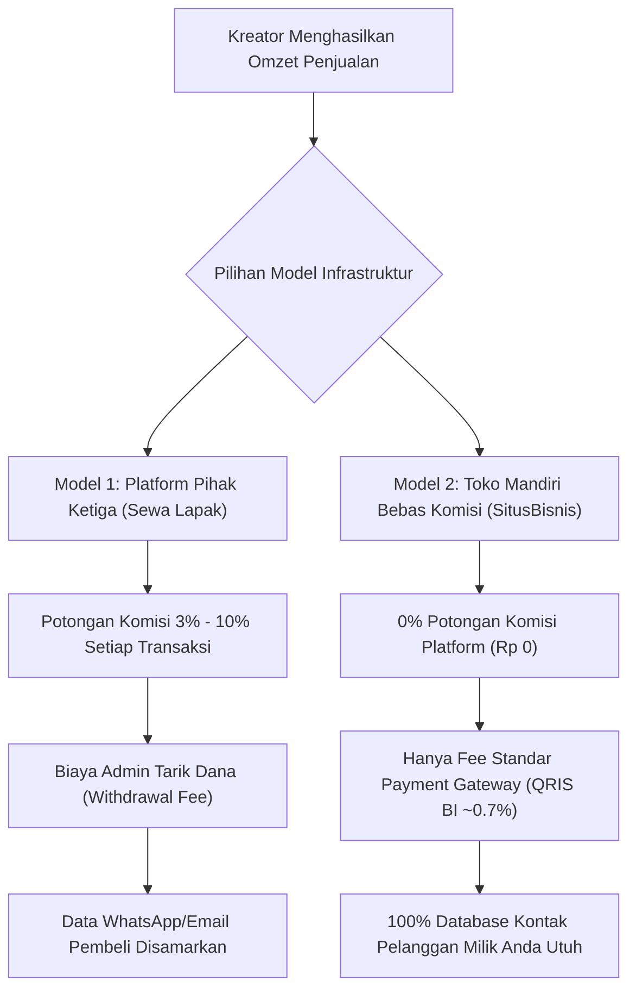
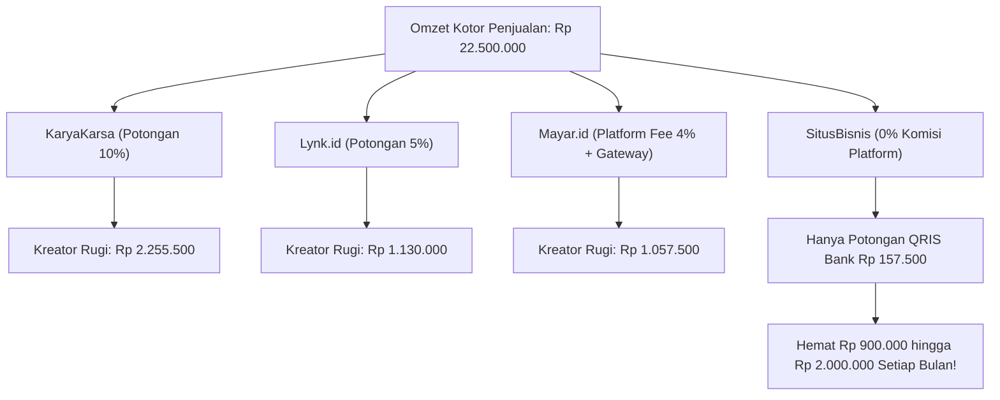

Bagi siapa pun yang menjual produk digital di Indonesia—entah itu e-book panduan, template dokumen kerja, preset video, rekaman workshop, atau sesi konsultasi—pertanyaan pertama yang selalu muncul di kepala adalah:

*"Enaknya jualan pakai platform apa ya biar cepat laku dan gak ribet?"*

Banyak pemula langsung tergiur mendaftar ke platform yang sering wira-wiri di bio Instagram atau TikTok para konten kreator. Di awal, semuanya terasa manis dan serba instan: tinggal daftar dengan email, unggah file, pasang tautan di profil, lalu tunggu orang membeli.

Namun, begitu produk Anda mulai meledak dan angka penjualan tembus puluhan hingga ratusan pesanan setiap bulan, sebuah kenyataan pahit baru disadari: **potongan komisi transaksi platform dan biaya penarikan saldo pelan-pelan menyedot jutaan rupiah dari kantong Anda.**

Bukan hanya itu, Anda tiba-tiba sadar bahwa ribuan pembeli yang sudah mentransfer uang tidak bisa Anda sapa ulang secara mandiri lewat WhatsApp atau email, karena **seluruh data kontak pelanggan Anda dikuasai dan dikunci oleh pihak platform**.

Artikel ini menyajikan riset objektif dan komparasi mendalam antara platform populer di Indonesia—seperti **Lynk.id, Mayar, KaryaKarsa, Tribelio**—serta membedah mengapa semakin banyak praktisi kini beralih ke **Toko Mandiri Bebas Komisi (Zero-Commission Storefront)** seperti di [SitusBisnis](https://situsbisnis.com).

---

## 1. Anatomi dan Bedah Biaya 4 Platform Populer di Indonesia

Mari kita bedah struktur biaya, model monetisasi, serta kelebihan dan batasan dari masing-masing platform berdasarkan data operasional terbaru.

### A. Lynk.id (Platform Link-in-Bio & Creator Storefront)
Lynk.id sangat populer di kalangan konten kreator media sosial karena proses pembuatannya yang ramah ponsel pintar (*mobile-friendly*) dan kemudahannya disematkan di bio profil.

* **Skema Biaya & Komisi:**
  - **Akun Gratis (Free):** Dikenakan potongan biaya layanan/komisi sebesar **5%** dari setiap transaksi penjualan.
  - **Akun Pro:** Biaya langganan sekitar **Rp 99.000 per bulan**, dengan potongan komisi transaksi diturunkan menjadi **3%**.
  - **Biaya Penarikan Saldo (Withdrawal):** Dikenakan biaya admin transfer bank sekitar **Rp 5.000** per penarikan, dengan batas minimum saldo penarikan tertentu.
* **Kelebihan:** Sangat cepat untuk pemula yang belum punya situs sendiri, katalog produk rapi di layar ponsel, dan mendukung pembayaran QRIS lokal.
* **Titik Gesek (Friction Point):**
  - Potongan komisi 5% terasa sangat berat saat omzet menyentuh angka belasan juta rupiah.
  - Tampilan berformat kartu *link-in-bio* kurang mencerminkan otoritas profesional bagi penjual produk B2B, konsultan premium, atau materi bernilai tinggi (*high-ticket*).

### B. Mayar.id (Platform Fintech Checkout & Payment Link)
Mayar memposisikan dirinya sebagai platform *fintech checkout* yang kuat untuk memproses berbagai tipe produk—mulai dari unduhan file, tiket webinar, penagihan invoice, hingga donasi.

* **Skema Biaya & Komisi:**
  - **Platform Fee Berlapis:** Mayar membebankan biaya platform berdasarkan kategori produk dan paket langganan. Untuk produk digital (seperti e-book, audio, modul), biayanya berkisar antara **3% hingga 4%** per transaksi pada paket Starter/Business.
  - **Payment Gateway Fee Tambahan:** Selain potongan platform, ada biaya jalur pembayaran (misal QRIS 0.7%, Virtual Account bank sekitar Rp 4.000 per transaksi, serta e-wallet 1.5% - 2%).
  - **Pajak PPN:** Dikenakan pada biaya transaksi sesuai regulasi.
* **Kelebihan:** Pilihan metode pembayaran terlengkap (VA multi-bank, e-wallet, kartu kredit, paylater), mendukung invoice resmi, dan fitur membership berulang.
* **Titik Gesek (Friction Point):**
  - Akumulasi biaya platform + biaya gateway + PPN membuat total potongan per transaksi bisa mencapai 4.5% hingga 6%.
  - Tampilan dashboard dan tautan pembayaran lebih bernuansa transaksi perbankan teknis daripada toko belanja produk digital yang ramah konsumen.

### C. KaryaKarsa (Platform Apresiasi Kreator & Paywall Konten)
KaryaKarsa awalnya dirancang untuk mendukung seniman, penulis cerita bersambung, komikus, dan ilustrator lokal agar bisa mendapatkan tip (*apresiasi*) atau mengunci bab berbayar.

* **Skema Biaya & Komisi:**
  - **Potongan Platform:** Memotong sebesar **10%** dari total penjualan atau dukungan yang diterima kreator.
  - **Biaya Pencairan Dana:** Dikenakan biaya transfer bank sekitar **Rp 5.500** per pencairan saldo.
* **Kelebihan:** Sudah memiliki ekosistem komunitas pembaca setia novel, fanfiction, dan komik daring yang aktif.
* **Titik Gesek (Friction Point):**
  - Potongan 10% adalah salah satu yang tertinggi di kategori platform lokal.
  - Mekanisme mata uang virtual (*Kakoin*) terkadang membingungkan calon pembeli umum yang hanya ingin membeli berkas panduan praktis sekali bayar.

### D. Tribelio / Tribelio Page (Platform Ekosistem & Landing Page)
Didirikan oleh pakar digital marketing Denny Santoso, platform ini memadukan pembuatan halaman penawaran (*landing page*), manajemen database prospek, dan pengiriman pesan siaran WhatsApp.

* **Skema Biaya & Komisi:**
  - **Model Berlangganan Tetap:** Paket Tribelio Page dan Basic berkisar antara **Rp 149.000 hingga Rp 198.000 per bulan**, sedangkan paket Premium mencapai **Rp 398.000 per bulan**.
  - **Biaya Transaksi:** Ada biaya gateway pembayaran per transaksi di luar biaya sewa langganan bulanan.
* **Kelebihan:** Sangat fokus pada konsep corong penjualan (*funnel*), integrasi broadcast WhatsApp, dan manajemen komunitas.
* **Titik Gesek (Friction Point):**
  - Beban biaya tetap bulanan (*fixed recurring cost*) yang harus dibayar setiap bulan, terlepas dari apakah bulan tersebut Anda sedang aktif jualan atau sedang sepi pembeli.
  - Antarmuka yang cukup kompleks dan membutuhkan kurva belajar bagi kreator pemula.

---

## 2. Tabel Simulasi Finansial Nyata: Siapa yang Menyedot Profit Anda Paling Banyak?

Mari kita uji dengan angka nyata di atas kertas kalkulator. Bayangkan Anda menjual modul panduan bisnis atau template spreadsheet seharga **Rp 150.000 per pesanan**. 

Dalam satu bulan, promosi Anda berjalan lancar dan menghasilkan **150 transaksi**, sehingga total omzet kotor Anda adalah **Rp 22.500.000**.

Berikut simulasi potongan biaya bersih yang terjadi di masing-masing platform:

| Parameter Evaluasi | Lynk.id (Akun Free) | Mayar.id (Starter) | KaryaKarsa | Toko Mandiri [SitusBisnis](https://situsbisnis.com) |
| :--- | :--- | :--- | :--- | :--- |
| **Omzet Kotor Bulanan** | Rp 22.500.000 | Rp 22.500.000 | Rp 22.500.000 | **Rp 22.500.000** |
| **Persentase Potongan Platform** | 5% | 4% (Kategori Digital) | 10% | **0% (Bebas Komisi)** |
| **Biaya Potongan Platform (Rupiah)** | -Rp 1.125.000 | -Rp 900.000 | -Rp 2.250.000 | **Rp 0** |
| **Estimasi Biaya Gateway (QRIS 0.7%)** | Termasuk / Variatif | -Rp 157.500 | Termasuk | **-Rp 157.500 (Langsung ke Bank)** |
| **Biaya Penarikan Dana (Withdrawal)** | -Rp 5.000 | Variatif | -Rp 5.500 | **Rp 0 (Otomatis Masuk Rekening)** |
| **Uang Bersih yang Masuk Rekening** | Rp 21.370.000 | Rp 21.442.500 | Rp 20.244.500 | **Rp 22.342.500** |
| **Selisih Uang yang Terselamatkan** | *Hilang Rp 972.500* | *Hilang Rp 900.000* | *Hilang Rp 2.098.000* | **Uang Anda Utuh 100%** |

> [!IMPORTANT]
> Kehilangan Rp 1.000.000 hingga Rp 2.000.000 setiap bulan mungkin terlihat kecil jika Anda hanya melihat persentase sekilas. Namun dalam kurun waktu 12 bulan (1 tahun), Anda sebenarnya telah menyedekahkan **Rp 12.000.000 hingga Rp 24.000.000** hanya untuk menyewa halaman checkout! Uang sebesar itu seharusnya bisa Anda pakai untuk anggaran iklan, riset materi baru, atau ditabung menjadi laba bersih bisnis Anda.

---

## 3. Bahaya Terbesar yang Jarang Dibahas: Kepemilikan Database Pelanggan

Potongan komisi uang memang menyakitkan, tapi ada kerugian jangka panjang yang jauh lebih berbahaya: **kehilangan kepemilikan data pembeli (*customer data hijacking*)**.

Perhatikan perbedaan mendasar ini:

### Skenario di Platform Pihak Ketiga
Ketika ada 200 orang membeli produk digital Anda di platform sewa, data nomor WhatsApp dan alamat email pembeli umumnya dikunci di dalam sistem tertutup mereka:
* Anda tidak bisa mengunduh daftar nomor WhatsApp pelanggan secara bebas untuk dihubungi ulang.
* Platform berhak menampilkan rekomendasi produk kreator lain di bagian bawah atau saat calon pembeli selesai membayar.
* Jika suatu hari akun Anda terkena penangguhan (*suspend*) atau platform tersebut tutup layanan, seluruh riwayat pembeli Anda musnah seketika.

### Skenario di Toko Mandiri [SitusBisnis](https://situsbisnis.com)
Setiap transaksi yang terjadi di toko Anda adalah aset milik Anda seutuhnya:
* **Database Bersih:** Nama lengkap, alamat email aktif, dan nomor WhatsApp tersimpan rapi di dashboard Anda dan bisa diekspor kapan saja.
* **Branding Mandiri:** Pembeli melihat identitas bisnis Anda, bukan logo platform pihak ketiga.
* **Mesin Penjualan Ulang (Repeat Order):** Saat bulan depan Anda merilis produk baru, Anda bisa menyapa kembali 200 pelanggan lama Anda secara langsung tanpa perlu membayar iklan lagi.

---

## 4. Fitur Esensial yang Wajib Dimiliki Toko Digital Modern

Jika Anda memutuskan untuk beralih dari platform sewa berbayar komisi ke toko mandiri, pastikan sistem yang Anda gunakan memiliki 5 pilar wajib berikut:

### 1. Pembayaran QRIS Dinamis Sekali Pindai
Di Indonesia, 85% transaksi produk digital diselesaikan melalui QRIS karena pembeli tidak perlu menyalin nomor rekening atau berpindah aplikasi bank secara rumit. Pastikan toko Anda langsung menampilkan QRIS dinamis di layar dan otomatis mendeteksi pelunasan dalam hitungan detik.

### 2. Pengiriman Akses Berkas Otomatis 24 Jam
Jangan gunakan sistem manual yang mengharuskan pembeli mengirim bukti transfer lalu menunggu Anda bangun tidur untuk mengirimkan tautan Google Drive. Sistem toko wajib mengarahkan pembeli langsung ke tombol unduh begitu pembayaran terverifikasi, sekaligus mengirimkan tautan cadangan ke WhatsApp atau email mereka.

### 3. Perlindungan Tautan Unduh Berbatas Waktu
Untuk mencegah file Anda disebarluaskan secara ilegal, tautan unduh harus dilindungi batas waktu kedaluwarsa (*expiring download token*) atau hanya dapat diakses melalui verifikasi email pembeli.

### 4. Notifikasi WhatsApp Real-Time
Toko mandiri modern wajib terhubung dengan gerbang notifikasi WhatsApp. Begitu pembayaran selesai, pesan resmi yang ramah berisi tanda terima dan instruksi penggunaan langsung masuk ke ponsel pembeli.

### 5. Dukungan Domain Kustom Sendiri
Menggunakan alamat toko sendiri (misal `toko.namabisnisanda.com` atau domain mandiri) meningkatkan tingkat kepercayaan pembeli hingga 3 kali lipat dibanding menggunakan subdomain generik dari platform sewa.

---

## 5. Matriks Perbandingan Ringkas: Menemukan Platform yang Tepat

| Kebutuhan Pengguna | Platform yang Sesuai | Pertimbangan Utama |
| :--- | :--- | :--- |
| **Kreator Pemula dengan 0 Produk & Ingin Coba-Coba** | Lynk.id (Akun Gratis) | Cepat untuk uji coba awal, asalkan Anda rela membayar komisi 5% dan biaya admin tarik dana. |
| **Penulis Cerita Bersambung / Komikus dengan Basis Fans** | KaryaKarsa | Cocok jika audiens Anda memang sudah terbiasa membeli koin bacaan digital di komunitas mereka. |
| **Pebisnis Korporat yang Butuh Penagihan Faktur Pajak B2B** | Mayar.id | Kuat di fitur perbankan korporasi, meski potongan berlapis harus diperhitungkan di harga jual. |
| **Praktisi, Konsultan, Mentor, & Solopreneur yang Ingin Laba Utuh 100%** | **[SitusBisnis](https://situsbisnis.com)** | **Pilihan terbaik: 0% komisi platform, 100% kepemilikan data WhatsApp pembeli, QRIS cepat, dan branding mandiri.** |

---

## 6. Saatnya Mengamankan Margin dan Memiliki Data Pembeli Sendiri

Menjual produk digital adalah salah satu model bisnis terbaik di era internet karena Anda hanya perlu membuat produknya satu kali dan bisa menjualnya ribuan kali tanpa biaya produksi fisik berulang.

Namun, model bisnis ini hanya akan menghasilkan kebebasan finansial jangka panjang jika Anda **tidak membiarkan margin keuntungan Anda tergerus komisi platform pihak ketiga yang tidak perlu**.

Langkah taktis yang bisa Anda ambil mulai hari ini:
1. **Audit Biaya Komisi Anda:** Buka mutasi saldo platform yang Anda gunakan saat ini. Hitung berapa ratus ribu atau jutaan rupiah yang sudah dipotong dari hasil kerja keras Anda selama 3 bulan terakhir.
2. **Amankan Aset Kontak Pembeli:** Mulai bangun toko mandiri dengan nama brand Anda sendiri.
3. **Alihkan Tautan Promosi:** Pasang tautan toko mandiri bebas komisi di bio media sosial dan konten edukasi Anda.

Dengan sistem etalase toko mandiri di **[SitusBisnis](https://situsbisnis.com)**, seluruh proses dari pemesanan, verifikasi QRIS, pengiriman berkas, hingga pencatatan database pelanggan berjalan otomatis di bawah kendali penuh Anda—tanpa potongan komisi sepeser pun.
