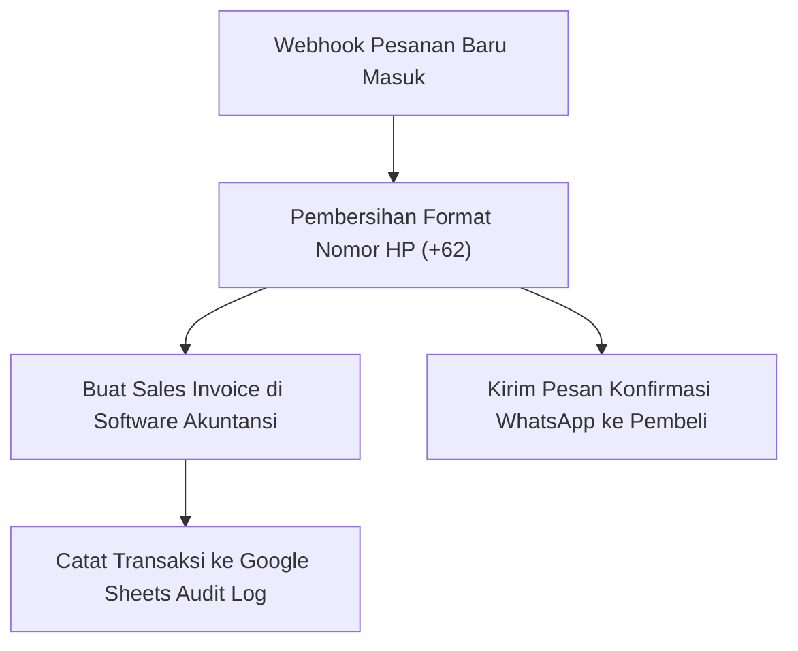

Membangun aplikasi Software as a Service (SaaS) sering dipuja sebagai puncak pencapaian bisnis digital. Namun kenyataan pahitnya: membangun SaaS membutuhkan modal besar, tim teknis berdedikasi untuk menangani server 24 jam, serta biaya pemeliharaan infrastruktur yang terus membengkak setiap bulan.

Padahal ada jalan pintas yang jauh lebih menguntungkan dengan margin bersih mendekati 100%: **menjual Pipeline Otomasi Siap Impor (*Importable Automation Blueprints*)**.

Bisnis di Indonesia saat ini menggunakan belasan aplikasi berbeda: pesanan masuk dari toko online, pencatatan di software akuntansi lokal (seperti Accurate atau Jurnal), komunikasi tim di WhatsApp dan Discord, serta database gudang di spreadsheet. Masalahnya? **Aplikasi-aplikasi ini tidak saling berbicara satu sama lain**.

Pemilik bisnis menghabiskan jutaan rupiah setiap bulan hanya untuk menggaji staf admin manual yang menyalin data dari satu layar ke layar lainnya.

```mermaid
graph TD
    A["Toko Online / POS Kasir"] -->|Staf Admin Salin Manual (Rentan Typo & Boros Waktu)| B["Software Akuntansi Accurate / Jurnal"]
    A -->|Staf Admin Kirim Manual Tiap Jam| C["Update Resi & Notifikasi WhatsApp"]
    
    D["Blueprint Otomasi n8n / Make Siap Pakai"] --> E["Sinkronisasi Real-Time Otomatis 0 Detik"]
    E --> B
    E --> C
```

## Anatomi Aset Otomasi yang Bernilai Tinggi

Aset otomasi digital bukan sekadar kode rumit, melainkan berkas JSON siap impor yang menyelesaikan gesekan operasional spesifik:

### 1. Sinkronisasi Pesanan Toko Online ke Software Akuntansi (Accurate / Jurnal)
Salah satu titik sakit terbesar pengusaha grosir dan distributor di Indonesia adalah pembuatan faktur pajak dan invoice akuntansi.
- Paket berkas JSON alur kerja (*workflow*) n8n atau Make.com.
- Logika pemetaan data: nama produk, PPN 11%, diskon voucher, hingga kode rekening buku besar otomatis terisi tanpa intervensi manusia.
- Penanganan jika stok di gudang tidak mencukupi saat sinkronisasi dilakukan.

### 2. Notifikasi Pengiriman dan Resi WhatsApp Otomatis
Pelanggan di Indonesia sangat cemas mengenai status paket pesanan mereka.
- Alur kerja yang membaca status kurir (JNE, SiCepat, J&T) melalui webhook pihak ketiga, lalu otomatis mengirimkan pesan WhatsApp personal ke pembeli saat paket bergerak atau tiba di alamat tujuan.
- Mengurangi pertanyaan "Pesanan saya sudah dikirim belum?" ke tim *customer service* hingga 80%.

### 3. Pipeline Pembersihan dan Pengayaan Data Kontak (Data Enrichment)
Bagi tim sales B2B:
- Workflow yang mendeteksi setiap pendaftaran prospek baru, memverifikasi apakah alamat email perusahaan aktif, mengecek domain website prospek, dan otomatis memasukkan data yang telah diperkaya ke CRM atau spreadsheet sales.



## Cara Menjual Blueprint Otomasi Tanpa Dimintai Dukungan Teknis Seumur Hidup

Tantangan terbesar menjual otomasi adalah pembeli yang gagap teknologi sering meminta bantuan instalasi tanpa henti. Kunci untuk menjaga margin tinggi adalah **standarisasi dokumentasi penyerahan**:

1. **Format Berkas JSON Standar Industri**: Ekspor alur kerja dari platform open-source seperti **n8n** (yang bisa di-hosting sendiri secara gratis oleh pembeli) atau Make.com. Pembeli cukup mengklik tombol *Import Workflow* dan memasukkan file JSON tersebut.
2. **Video Panduan "Layar ke Layar" 15 Menit**: Rekam video langkah demi langkah tanpa jeda yang menunjukkan di mana pembeli harus menempelkan API Key mereka. Jangan berasumsi pembeli paham istilah teknis seperti *Bearer Token* atau *Payload*.
3. **Penyediaan Opsi Upsell Instalasi Kilat (*Done-For-You Add-on*)**:
   - Lisensi Blueprint JSON + Video Panduan Mandiri: Rp 790.000 (100% pasif).
   - Add-on "Instalasi oleh Tim Kami dalam 24 Jam": Tambahan Rp 1.500.000. Klien korporat yang sibuk akan dengan senang hati mengambil opsi kedua.

## Ekosistem Toko Mandiri untuk Produk Otomasi

Menjual blueprint alur kerja digital membutuhkan platform yang memahami pengiriman berkas digital terenkripsi dan integrasi checkout instan.

Dengan toko mandiri di [SitusBisnis](https://situsbisnis.com), Anda bisa menyajikan halaman penjualan visual lengkap dengan tangkapan layar alur kerja, menerima pembayaran via QRIS dan Virtual Account, serta otomatis mengirimkan link Google Drive berisi file JSON dan dokumentasi panduan tanpa potongan komisi sepeser pun.
