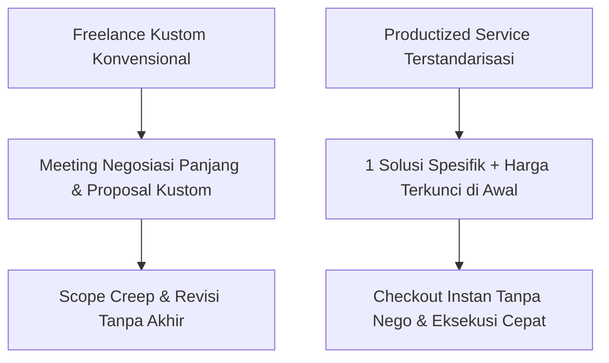
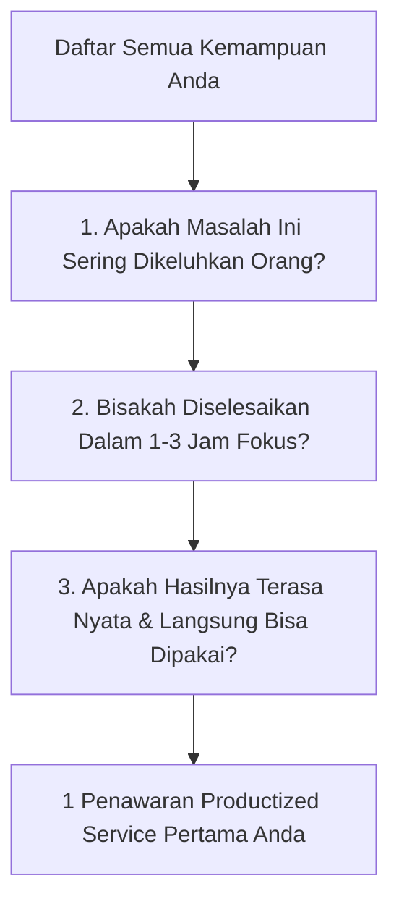

Hampir semua pekerja lepas (*freelancer*), desainer, konsultan, atau mentor di Indonesia pernah terjebak dalam siklus yang sama:
1. Mendapat prospek baru dari kenalan atau media sosial.
2. Meluangkan waktu meeting online 45 menit hanya untuk mendengarkan keluhan umum klien yang belum tentu jadi order.
3. Begadang 2 hari menyusun proposal kustom setebal belasan halaman.
4. Menghadapi tawar-menawar alot via WhatsApp: *"Kak, budget kantor kami tinggal setengahnya nih, bisa kurang ya?"*
5. Begitu disepakati, Anda malah terseret ke dalam lingkaran revisi ke-7 yang bikin frustrasi.

Model kerja serba kustom seperti ini pelan-pelan membunuh kesehatan dan pertumbuhan finansial Anda. Sebagian besar energi habis untuk urusan administrasi negosiasi, bukan untuk berkarya.

Di artikel pembuka seri *Productized Service Playbook* ini, kita akan membedah jalan keluar dari jebakan "menukar jam dengan uang": **mengambil satu keahlian terkuat Anda, membungkusnya menjadi paket solusi terstandarisasi dengan batasan paten, dan menjualnya layaknya produk di keranjang belanja online**.

## Membedakan Jasa Kustom dengan Productized Service

Untuk memahami perbedaannya, mari kita bandingkan cara lama dengan cara baru pada keahlian yang sama:

| Parameter | Cara Freelance Konvensional | Cara Productized Service |
| :--- | :--- | :--- |
| **Deskripsi Jasa** | "Saya desainer grafis, bisa bikin apa saja: logo, banner, feed IG, brosur." | "Audit Landing Page 48 Jam: 5 Rekomendasi Visual Penaik Konversi." |
| **Penetapan Harga** | "Tergantung tingkat kesulitan, silakan chat dulu untuk penawaran." | "Rp 1.490.000 sekali bayar (Lunas di depan sebelum audit dimulai)." |
| **Batas Waktu** | Sering molor berminggu-minggu karena menunggu feedback klien. | Pasti: Dokumen audit diserahkan tepat 48 jam setelah formulir brief diisi. |
| **Jumlah Revisi** | Tidak terbatas atau sering kebablasan karena sungkan menolak. | 1 Sesi tanya jawab tertulis selama 24 jam setelah laporan diserahkan. |

## 3 Saringan Memilih 1 Keahlian Paling Menghasilkan

Jangan mencoba mengemas semua hal yang bisa Anda lakukan sekaligus. Gunakan **Saringan 3-T** (*Terbukti, Terbatas, Terasa*):

### 1. Terbukti Sering Ditanyakan Orang
Ingat-ingat pesan chat atau pertanyaan yang paling sering masuk ke Anda selama 6 bulan terakhir:
- *"Kak, tolong liatin dong kenapa iklan saya gak ada yang ngeklik?"* $\rightarrow$ Produk: **Audit Struktur Iklan 24 Jam**.
- *"Mas, bisa bantu hitungin harga jual menu kafe saya gak?"* $\rightarrow$ Produk: **Kalkulasi COGS 10 Menu Kuliner**.

### 2. Terbatas Waktu Pengerjaannya (Under 3 Hours)
Pilihlah pekerjaan yang bagi orang awam memusingkan, tetapi bagi Anda yang sudah berpengalaman bisa diselesaikan dalam waktu 1 hingga 3 jam kerja fokus.

### 3. Terasa Dampaknya Secara Instan
Klien harus bisa merasakan hasil konkret dalam waktu singkat. Bukan janji "pertumbuhan jangka panjang yang abstrak", melainkan berkas rekomendasi yang bisa langsung mereka terapkan besok pagi.

## Langkah Praktis Anda Hari Ini

Ambil secarik kertas, tuliskan 3 keahlian Anda, lalu ubah judulnya dari nama profesi menjadi **hasil akhir yang diterima klien**.
- Bukan: "Jasa Konsultan Pajak UMKM".
- Melainkan: **"Pemeriksaan Kesiapan Laporan Pajak Tahunan UMKM Bebas Denda"**.

Di bagian selanjutnya (**Part 2: Menetapkan Batasan Ruang Lingkup Anti Revisi Tanpa Henti**), kita akan membahas bagaimana merumuskan batasan kerja kaku agar Anda terbebas selamanya dari klien yang meminta revisi di luar kesepakatan.
