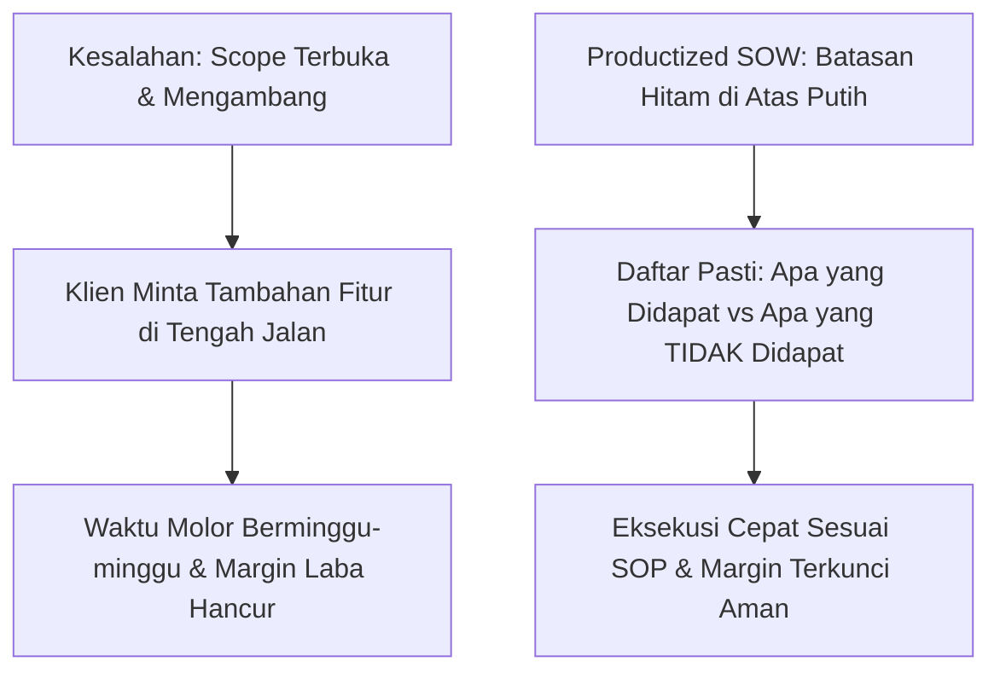
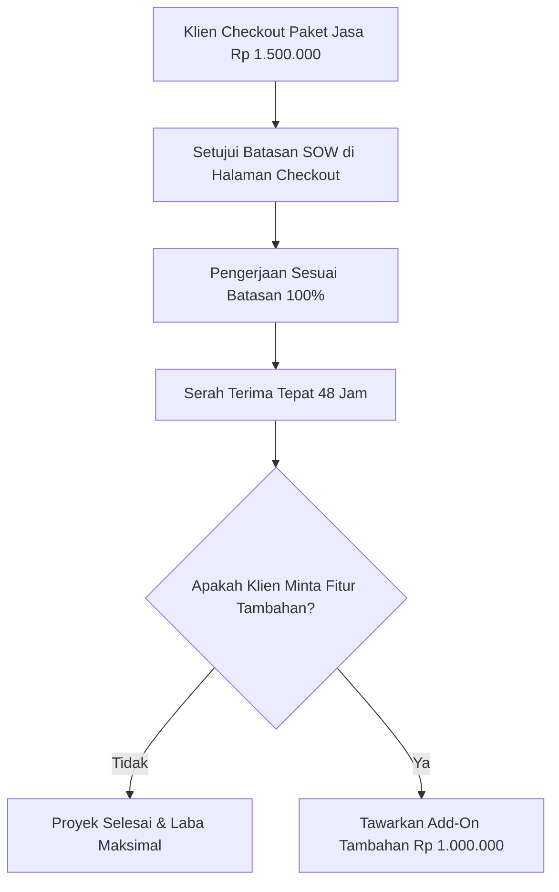

Pernahkah Anda menyepakati proyek pembuatan desain atau audit seharga Rp 1.500.000, lalu di minggu ketiga klien dengan santai mengirim chat: *"Mas, tolong sekalian buatkan kop surat, kartu nama, sama spanduk tokonya ya, kan masih satu tema?"*

Kalau Anda menolak, klien mengancam menahan sisa pelunasan. Tapi kalau dituruti, waktu kerja Anda molor dua minggu dan nilai upah per jam Anda langsung anjlok bebas di bawah upah minimum.

Inilah fenomena *scope creep*—ruang lingkup kerja liar yang membengkak di tengah jalan tanpa kompensasi sepeser pun.

Di [panduan pertama](/posts/productized-service-part-1-menemukan-keahlian-spesifik/), kita sudah mengunci satu keahlian spesifik bernilai tinggi. Sekarang di bagian kedua seri *Productized Service Playbook*, kita akan melindunginya: **bagaimana menyusun batasan ruang lingkup kerja (*Scope of Work*) yang transparan dan tak terbantahkan**, sehingga klien tahu persis batas hak mereka dan Anda terlindungi dari lingkaran revisi tak berujung.

## Anatomi Formula "Yang Didapat vs Yang Tidak Didapat"

Di halaman penjualan produk jasa Anda, jangan hanya menuliskan apa yang akan dikerjakan. **Yang jauh lebih penting adalah menuliskan apa yang secara tegas TIDAK termasuk dalam paket tersebut**.

Perhatikan contoh formulasi kontrak terbuka berikut untuk produk *Audit Toko Online 48 Jam*:

### 1. Apa yang Pasti Didapat Klien (The Deliverables)
- 1 Dokumen Laporan Evaluasi PDF 15 Halaman mencakup kecepatan loading, kenyamanan checkout di ponsel, dan struktur navigasi produk.
- 1 Video Rekaman Layar 10 Menit membedah langsung celah gesekan di toko online klien.
- 1 Sesi Tanya Jawab Tertulis via WhatsApp selama 24 jam setelah laporan diserahkan.
- **Tenggat Penyerahan**: Tepat 48 jam hari kerja setelah formulir brief diisi lengkap oleh klien.

### 2. Apa yang Secara Tegas TIDAK Didapat Klien (The Exclusions)
- Tidak termasuk memperbaiki koding website secara langsung.
- Tidak termasuk membuatkan materi foto produk atau copywriting baru.
- Tidak termasuk panggilan video/Zoom di luar kesepakatan tertulis.
- *(Catatan: Jika klien membutuhkan implementasi koding, mereka dapat memesan Paket Lanjutan terpisah).*

Ketika batasan ini ditulis dengan huruf tebal dan jelas di halaman checkout, klien tidak bisa lagi beralasan *"Saya kira sudah termasuk semuanya"*.

## Menghilangkan Jebakan Meeting Asinkron (No-Meeting Policy)

Tahukah Anda apa yang paling banyak memakan waktu seorang profesional? **Meeting basa-basi selama 60 menit yang sebenarnya bisa diselesaikan dalam 3 baris pesan teks**.

Dalam model *Productized Service*, terapkan kebijakan **Komunikasi Asinkron (*Asynchronous Communication*)**:
1. Tidak ada meeting tatap muka atau video call untuk pengumpulan data awal. Semua data yang Anda butuhkan wajib diisi klien melalui formulir kuesioner terstruktur.
2. Hasil kerja diserahkan dalam bentuk berkas PDF rapi disertai video penjelasan layar singkat (misal menggunakan rekaman Loom atau Google Drive video).
3. Klien menyukai cara ini karena mereka bisa menonton video penjelasan Anda kapan saja tanpa harus mencocokkan jadwal kalender meeting yang padat.

Di bagian berikutnya (**Part 3: Membangun Etalase Pemesanan Mandiri dengan Formulir Kuesioner Instan**), kita akan merancang bagaimana menghubungkan sistem pembayaran QRIS langsung ke formulir kuesioner brief otomatis tanpa Anda harus mengirim pesan manual satu per satu.
