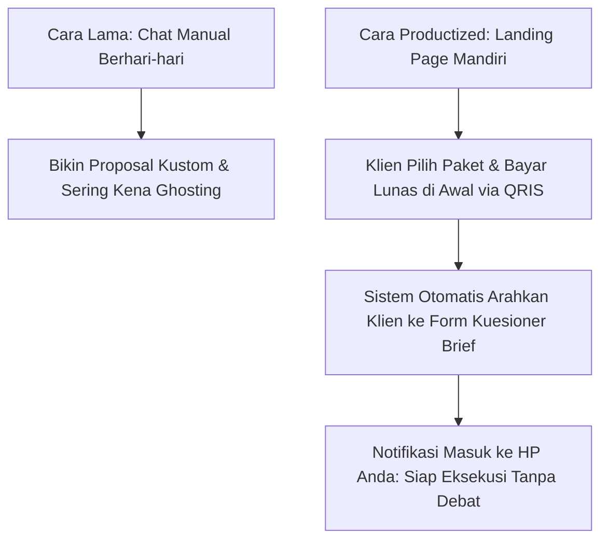
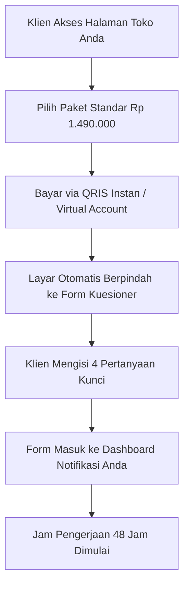

Coba hitung berapa jam waktu berharga Anda yang terbuang sia-sia setiap minggu hanya untuk melayani pesan obrolan seperti ini:
- *"Kak, kisaran tarif jasanya berapa ya?"*
- *"Boleh kirim contoh portofolio yang mirip bidang usaha saya?"*
- *"Bisa tolong buatkan proposal penawaran dulu gak untuk saya ajukan ke atasan?"*

Lalu setelah Anda meluangkan waktu berjam-jam menyusun penawaran dan meladeni obrolan tersebut, calon klien itu tiba-tiba menghilang tanpa kabar (*ghosting*).

Setelah di [bagian kedua](/posts/productized-service-part-2-batasan-ruang-lingkup-anti-revisi/) kita berhasil mengunci batasan ruang lingkup kerja anti-revisi, saatnya menghentikan pemborosan waktu terbesar ini. Di artikel ketiga seri *Productized Service Playbook*, kita akan mengubah penawaran jasa Anda menjadi **Etalase Mandiri (*Self-Service Storefront*)**: sistem di mana calon klien melihat paket transparan, membayar di awal sebelum pengerjaan dimulai, dan mengisi formulir brief otomatis tanpa perlu Anda pandu lewat obrolan manual.

## Anatomi Halaman Pemesanan Productized Service

Halaman penawaran Anda tidak boleh terlihat rumit. Fokuskan halaman pada 4 elemen penting yang menghilangkan keraguan pembeli:

### 1. Masalah Utama yang Dibereskan (Headline Nyeri Nyata)
Bukan: *"Selamat datang di portofolio jasa konsultasi saya"*.
Melainkan: *"Tingkatkan Konversi Checkout Toko Anda dalam 48 Jam Tanpa Ganti Desain Website"*.

### 2. Tiga Pilihan Paket Jelas (Good, Better, Best)
Beri klien kendali pilihan tanpa perlu meminta penawaran kustom:
- **Paket Cepat (Audit Dasar)**: Laporan evaluasi 10 halaman (Rp 750.000).
- **Paket Standar (Audit + Video Bedah Layar)**: Pilihan paling populer yang mencakup video 15 menit (Rp 1.490.000).
- **Paket Lengkap (Audit + Template Copywriting Siap Pasang)**: Solusi menyeluruh untuk klien yang ingin terima beres (Rp 2.900.000).

### 3. Formulir Kuesioner Pengumpulan Data (Intake Form)
Kunci otomatisasi pengerjaan Anda terletak pada formulir ini. Setelah klien menyelesaikan pembayaran QRIS di toko Anda, sistem otomatis mengarahkan mereka ke formulir Google Forms, Tally, atau Notion form dengan pertanyaan terarah:
1. Apa alamat URL website atau akun bisnis yang ingin diaudit?
2. Siapa target audiens utama produk Anda?
3. Apa kendala nomor satu yang paling sering Anda dengar dari calon pembeli Anda?
4. Tautan aset grafis atau data pendukung yang perlu kami ketahui.

## Membunuh Hambatan Pembayaran di Depan

Banyak penyedia jasa takut meminta pembayaran lunas di depan. Mereka khawatir klien kabur.

Kenyataannya justru sebaliknya: **Klien profesional dan pemilik bisnis lebih menyukai pembayaran di depan karena memberikan kepastian jadwal**.

Agar klien merasa sangat aman saat membayar di muka:
- Pasang tombol pembayaran resmi dengan opsi QRIS dan Virtual Account Bank Nasional.
- Berikan jaminan tenggat waktu: *"Jika laporan tidak kami serahkan dalam tempo 48 jam hari kerja, uang Anda kami kembalikan 100% dan laporan tetap menjadi milik Anda secara gratis."*

Dengan menggunakan toko digital mandiri di [SitusBisnis](https://situsbisnis.com), Anda bisa membuat halaman produk jasa ini dalam hitungan menit, menerima pembayaran instan tanpa potongan komisi, dan otomatis mengarahkan klien ke formulir kuesioner brief kerja Anda.

Di bagian penutup (**Part 4: Otomasi Onboarding Klien Tanpa Chat Manual Berhari-hari**), kita akan membahas alur penyerahan dokumen hasil kerja dan bagaimana mengubah klien satu kali menjadi pelanggan retain tahunan.
