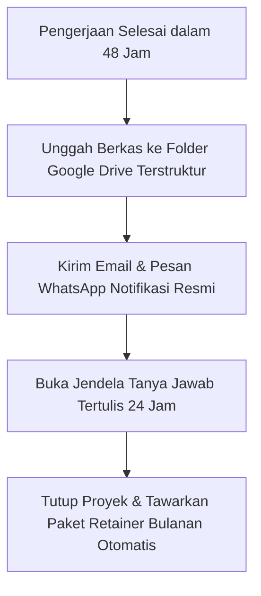
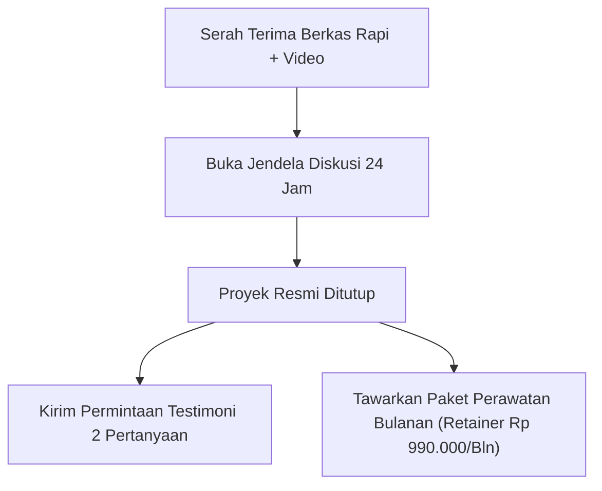

Banyak penyedia jasa bekerja keras saat mengerjakan proyek, tapi hancur berantakan di garis finis: mengirim tautan berkas acak lewat pesan WhatsApp, lupa memberi panduan cara menggunakannya, dan akhirnya harus meladeni pertanyaan teknis klien yang sama selama berminggu-minggu ke depan.

Kesan pertama memang penting, tapi kesan terakhir (*last impression*) adalah penentu mutlak apakah klien akan merekomendasikan nama Anda ke koleganya atau justru kapok bekerja sama lagi.

Di [bagian ketiga](/posts/productized-service-part-3-etalase-pemesanan-kuesioner-instan/), etalase mandiri dan kuesioner otomatis kita sudah berjalan mulus. Kini, di artikel penutup seri *Productized Service Playbook*, kita akan membedah mata rantai yang membedakan pekerja lepas serabutan dengan pemilik agensi modern: **Protokol Serah Terima Elegan (*The Frictionless Hand-off*) dan otomatisasi paket langganan bulanan (*retainer*)** agar satu klien setia bisa mendatangkan pemasukan rutin setiap bulan.

Sebaliknya, penyedia *Productized Service* kelas dunia memiliki **Protokol Serah Terima Elegan (The Frictionless Hand-off)** yang membuat klien merasa terlayani layaknya korporasi besar, meski Anda menjalankannya seorang diri dari rumah.



## Struktur Folder Penyerahan yang Terlihat Mahal

Jangan pernah mengirim berkas lampiran mentah berantakan di WhatsApp. Siapkan satu tautan folder privat Google Drive atau Notion Workspace dengan struktur penamaan yang profesional:

```
📁 [Nama Klien] - Paket Audit 48 Jam
│
├── 📄 01-Ringkasan-Eksekutif-Hasil-Audit.pdf
├── 🎥 02-Video-Bedah-Layar-10-Menit.mp4 (atau tautan video)
├── 📊 03-Lembar-Kerja-Action-Plan.xlsx
└── 📜 04-Panduan-Langkah-Implementasi-Besok-Pagi.pdf
```

Ketika klien membuka tautan dan melihat penomoran dokumen yang rapi, persepsi profesionalisme Anda melonjak 300%. Mereka merasa uang Rp 1.500.000 yang mereka bayarkan sangat layak dan murah.

## Menutup Proyek dengan Jendela Tanya Jawab Terbatas (24-Hour Q&A Window)

Agar Anda tidak terus diganggu pesan chat berminggu-minggu setelah proyek selesai, kunci komunikasi dengan batas waktu yang etis:

Kirim pesan penyerahan resmi berikut:

> *"Halo Kak [Nama], berkas hasil pengerjaan Paket Audit 48 Jam untuk bisnis Kakak sudah selesai dan dapat diakses melalui tautan folder privat berikut: [Tautan Folder].*
>
> *Untuk memastikan implementasi berjalan lancar, kami membuka **Jendela Diskusi & Tanya Jawab Tertulis selama 24 jam ke depan** (hingga besok pukul 17.00 WIB). Silakan pelajari berkasnya, dan jika ada hal teknis yang perlu diklarifikasi, Kakak bisa langsung tanyakan di sini."*

Dengan cara ini:
- Klien merasa dihargai karena diberi waktu khusus untuk bertanya.
- Anda memiliki kepastian mutlak kapan proyek tersebut resmi ditutup.



## Mengubah Proyek Sekali Beli Jadi Gaji Bulanan (Retainer Offer)

Momen terbaik untuk menjual jasa lanjutan adalah **tepat saat klien baru saja merasakan kepuasan dari hasil kerja pertama Anda**.

Setelah proyek ditutup, ajukan penawaran pemeliharaan berkala:
> *"Kak [Nama], audit bulan ini menunjukkan 3 celah utama di toko Kakak. Agar metrik performa toko Kakak tetap stabil dan tidak turun lagi di bulan-bulan depan, kami punya program **Monthly Retainer Monitoring** seharga Rp 990.000/bulan: kami akan menginspeksi toko Kakak setiap tanggal 1 dan mengirimkan laporan berkala otomatis. Jika Kakak ingin slot ini diamankan, silakan aktifkan di tautan toko kami berikut."*

Jika Anda memiliki **10 klien retainer yang membayar Rp 990.000/bulan**, Anda telah mengamankan **gaji rutin hampir Rp 10 juta per bulan** hanya dengan bekerja beberapa jam seminggu!

Dengan platform toko mandiri seperti [SitusBisnis](https://situsbisnis.com), Anda memegang kendali penuh atas katalog produk jasa, formulir kuesioner instan, hingga sistem pembayaran QRIS tanpa potongan komisi sepeser pun.

---

### Rangkuman Seri Productized Service Playbook
1. **[Part 1: Menemukan Satu Keahlian Spesifik](/posts/productized-service-part-1-menemukan-keahlian-spesifik/)**: Saring keahlian yang sering ditanyakan dan kemas jadi hasil akhir nyata.
2. **[Part 2: Batasan Ruang Lingkup Anti Revisi](/posts/productized-service-part-2-batasan-ruang-lingkup-anti-revisi/)**: Tulis apa yang didapat vs apa yang secara tegas tidak didapat untuk mencegah scope creep.
3. **[Part 3: Etalase Pemesanan & Kuesioner Instan](/posts/productized-service-part-3-etalase-pemesanan-kuesioner-instan/)**: Pembayaran lunas di awal via QRIS terintegrasi formulir brief otomatis.
4. **[Part 4: Otomasi Onboarding & Retainer](/posts/productized-service-part-4-otomasi-onboarding-tanpa-chat-manual/)**: Penyerahan terstruktur dengan jendela Q&A 24 jam dan konversi ke langganan bulanan.
