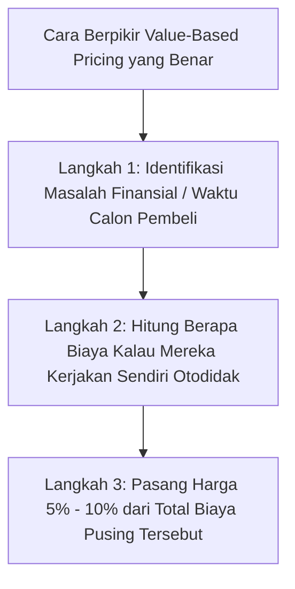
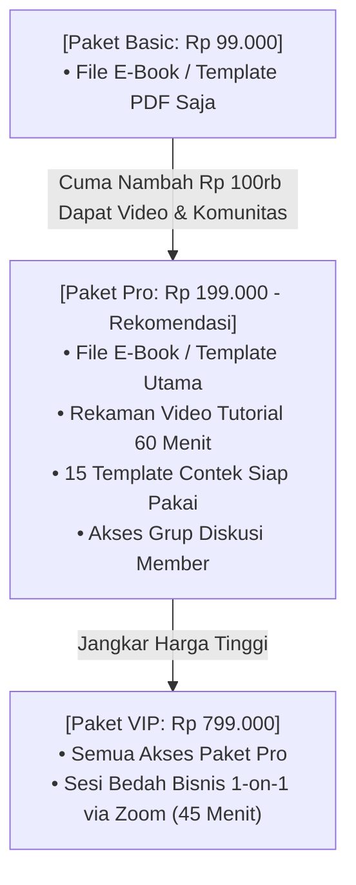

Pernah nggak kamu mau merilis e-book, template, atau kelas online pertamamu, lalu tiba-tiba kepalamu dipenuhi rasa cemas:
> *"Kalau saya pasang harga Rp 200 ribu, kemahalan nggak ya? Nanti ada yang beli nggak? Apa saya pasang Rp 25 ribu aja ya biar laku keras?"*

Jujur, hampir semua kreator pernah berada di posisi itu. 

Rasa takut ditolak (*fear of rejection*) sering kali membuat kreator pemula banting harga gila-gilaan: menjual modul 8 jam atau template spreadsheet yang dibuat berbulan-bulan seharga secangkir kopi sachet.

Tapi tahukah kamu apa yang sering terjadi di dunia nyata?

Ketika hargamu terlalu murah (misalnya e-book Rp 15.000 atau template Rp 10.000), calon pembeli di Indonesia **justru curiga**:
- *"Kok murah banget ya? Jangan-jangan ini hasil copas gratisan dari Google?"*
- *"Paling isinya cuma rangkuman dangkal, buang-buang waktu aja kalau dibaca."*
- *"Jangan-jangan ini link jebakan phishing atau penipuan?"*

Alih-alih laris manis, **underpricing ekstrem malah menghancurkan rasa percaya calon pembeli**.

Di artikel ini, kita akan bedah sains psikologi penetapan harga produk digital yang ramah di kantong pembeli, menguntungkan buat bisnismu, dan bebas dari sindrom minder!

---

## 1. Berhenti Menghitung Biaya Produksi, Hitung Nilai Penyelamatannya

Kalau kamu jualan gorengan atau kaos oblong, wajar menghitung harga berdasarkan modal tepung atau kain (Cost-Plus Pricing).

Tapi produk digital itu beda. Biaya untuk mengirim file ke 1 orang atau 1.000 orang sama-sama **nol rupiah** (Zero Marginal Cost). 

Oleh karena itu, jangan pernah pasang harga berdasarkan *"berapa jam waktu yang kamu habiskan buat bikin materinya"*. Pasanglah harga berdasarkan **berapa banyak waktu, uang, atau rasa pusing yang berhasil kamu hematkan untuk pembelimu**:

### Contoh Kasus Nyata:
Bayangkan kamu membuat template spreadsheet laporan keuangan UMKM:
- Kalau pemilik kafe harus sewa akuntan privat tiap bulan: biayanya minimal **Rp 1.500.000 per bulan** (Rp 18 juta setahun).
- Kalau pemilik kafe mencoba bikin rumus Excel sendiri dari nol: mereka butuh waktu **40 jam trial-and-error** sambil pusing kepala.
- Kalau kamu menjual template spreadsheet siap pakai yang langsung menyelesaikan masalah itu seharga **Rp 199.000**: apakah itu mahal?

Sama sekali tidak! Bagi si pemilik kafe, mengeluarkan Rp 199.000 adalah keputusan yang sangat masuk akal karena menyelamatkan belasan juta rupiah uang mereka!

---

## 2. Trik Tiga Pilihan Paket yang Bikin Pembeli Memilih Sendiri

Pernah ke bioskop mau beli popcorn?
- Ukuran Small: Rp 35.000
- Ukuran Medium: Rp 55.000
- Ukuran Large: Rp 60.000

Mayoritas orang akan langsung beli ukuran Large, karena mikir: *"Tanggung banget, cuma nambah Rp 5.000 dapet ukuran paling gede!"*

Trik psikologis ini dikenal sebagai **Decoy Effect (Efek Umpan)**. Di toko digitalmu, jangan cuma jual 1 harga mati. Tawarkan 3 pilihan paket seperti ini:

Ketika ada Paket VIP seharga Rp 799.000 di sampingnya:
- Harga Paket Pro Rp 199.000 seketika terasa **sangat ramah dan terjangkau**.
- Pembeli merasa rugi kalau cuma ambil Paket Basic, karena dengan menambah sedikit uang mereka mendapatkan bonus melimpah di Paket Pro.
- Secara alami, **70% pembeli akan memilih Paket Pro!**

---

## 3. Matriks Titik Manis (Sweet Spot) Harga Produk Digital di Indonesia

Berdasarkan daya beli rata-rata masyarakat lokal, berikut acuan rentang harga yang paling lancar konversinya:

| Kategori Produk | Rentang Harga Manis | Pola Transaksi Pembeli |
| :--- | :--- | :--- |
| **Impulse Buy (Tanpa Pikir Panjang)** | Rp 49.000 – Rp 99.000 | Langsung scan QRIS di HP tanpa perlu izin pasangan atau mikir anggaran. |
| **Core Value (Pertimbangan Logis)** | Rp 149.000 – Rp 349.000 | Pembeli butuh membaca landing page dan melihat testimoni bukti nyata. |
| **High Commitment (Investasi Karir/Bisnis)** | Rp 499.000 – Rp 1.500.000 | Butuh jaminan garansi yang jelas dan pendampingan materi intensif. |

---

## 4. Cara Elegan Menghadapi Calon Pembeli yang Minta Diskon

Di Indonesia, kamu pasti akan sesekali nemu orang yang chat: *"Kak, bisa kurang nggak harganya? Buat mahasiswa nih."*

Bagaimana meresponsnya tanpa merusak harga pasaran?
- ❌ **Jangan turunkan harga produk utama:** Kalau kamu langsung kasih diskon seenaknya di chat, mereka bakal merasa tokomu nggak profesional.
- ✅ **Alihkan ke produk paket bawah (Downsell):**  
  > *"Halo Kak! Untuk paket lengkap materinya memang investasinya Rp 199.000 karena sudah termasuk video dan template. Tapi kalau budget kakak sedang terbatas, kakak bisa ambil paket modul intinya saja seharga Rp 79.000 di link ini ya. Ilmunya tetap sangat bermanfaat buat mulai!"*

Dengan cara ini, kamu tetap menghormati anggaran mereka tanpa harus menurunkan wibawa nilai produkmu.

---

## Inti Pelajaran

Harga produk digitalmu adalah cerminan dari rasa percaya dirimu terhadap solusi yang kamu tawarkan.

Jangan takut mematok harga yang layak jika karyamu benar-benar memotong jalan berliku orang lain. Pasang sistem checkout QRIS yang mulus di platform mandirimu seperti di [SitusBisnis](https://situsbisnis.com), dan biarkan nilai nyata yang kamu berikan bekerja menghasilkan omzet impianmu!
