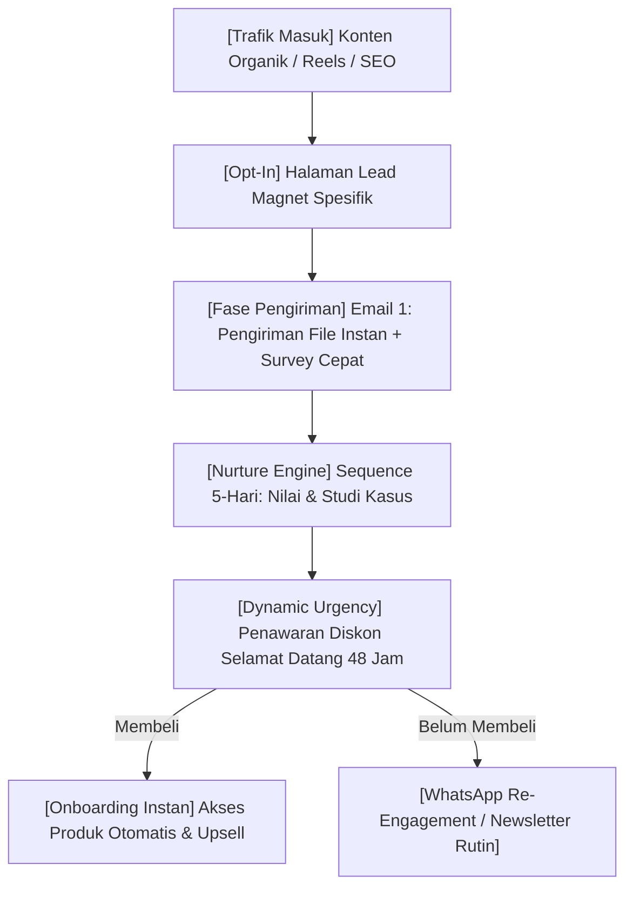

Banyak kreator dan mentor digital terjebak dalam siklus *"rollercoaster finansial"*: bulan ini panen ratusan juta rupiah karena sedang melakukan *launching* besar-besaran, namun tiga bulan berikutnya nihil penjualan karena mereka kelelahan membuat konten dan melayani komplain teknis.

Siklus peluncuran musiman (*launch-based model*) menuntut energi yang masif:
1. Menghabiskan energi 4–8 minggu untuk membangun antisipasi.
2. Membuka keran penjualan selama 5–7 hari dengan stres tinggi.
3. Mengalami penurunan tajam (*crash*) begitu periode pendaftaran ditutup.

Kenyataan bagi solopreneur dan kreator modern adalah: **Anda tidak bisa mempertahankan pertumbuhan bisnis yang sehat jika pendapatan Anda hanya bergantung pada momen peluncuran sporadis.**

Solusinya adalah mentransisikan produk digital terbaik Anda ke dalam **Sistem Penjualan Evergreen**—sebuah mesin penjualan terotomasi yang menyambut prospek baru setiap hari, memelihara hubungan secara personal, dan menyodorkan penawaran tepat di saat audiens paling membutuhkannya.

---

## 1. Perbedaan Mendasar: Funnel Peluncuran vs. Funnel Evergreen

Memahami perbedaan mentalitas antara model peluncuran dan model evergreen adalah kunci agar Anda tidak salah menyusun arsitektur sistem:

| Parameter Evaluasi | Model Peluncuran Musiman (Live Launch) | Model Evergreen Terotomasi (Evergreen Funnel) |
| :--- | :--- | :--- |
| **Pola Arus Kas** | Fluktuatif dan tinggi lonjakan (boom-and-bust). | Konsisten, terprediksi, dan mengalir harian. |
| **Tingkat Stres Kreator** | Sangat tinggi selama 7–14 hari masa kampanye. | Rendah dan terdistribusi merata sepanjang tahun. |
| **Waktu Konversi** | Dipaksakan oleh kalender kreator. | Ditentukan oleh kesiapan psikologis calon pembeli. |
| **Ketergantungan Energi** | Membutuhkan siaran langsung, webinar harian, & email blast. | Berjalan otomatis via trigger email dan integrasi webhook. |
| **Trafik yang Dibutuhkan** | Banjir trafik simultan dalam rentang waktu singkat. | Aliran trafik harian yang stabil dari konten pilar & SEO. |

> **Catatan Strategis:**
> Evergreen bukan berarti produk Anda "dipajang pasif" di website lalu berharap ada orang tersesat yang membeli. Evergreen adalah *peluncuran personal miniatur* yang dialami oleh masing-masing prospek berdasarkan tanggal mereka pertama kali mengunduh lead magnet Anda.

---

## 2. Peta Rantai Alur Penjualan Evergreen

Berikut adalah cetak biru alur kerja sistem penjualan evergreen yang menghubungkan magnet prospek, urutan edukasi bernilai tinggi, hingga gerbang pembayaran otomatis:

Ketika seorang prospek mendaftarkan nama dan email mereka di formulir lead magnet Anda pada hari Selasa pukul 14:15, "jam hitung mundur" untuk orang tersebut baru dimulai. Mereka akan menerima urutan pesan yang terukur, tanpa mengganggu prospek lain yang sudah bergabung bulan lalu.

---

## 3. Empat Pilar Penopang Mesin Evergreen yang Sehat

Untuk membuat mesin ini bekerja tanpa pengawasan harian, ada 4 komponen teknologi dan strategi yang harus saling terhubung:

### 1. Ingestion Point (Titik Masuk Prospek)
Titik masuk harus berupa solusi spesifik yang dapat dikonsumsi dalam waktu kurang dari 15 menit (misalnya checklist kerja, kalkulator spreadsheet, atau video studi kasus 10 menit). Semakin cepat prospek mendapatkan kemenangan kecil (*quick win*), semakin tinggi kepercayaan mereka terhadap produk berbayar Anda.

### 2. Relational Sequence (Jembatan Hubungan Emosional)
Jangan langsung menjual di email pertama. Gunakan 3 email awal untuk:
- Mengonfirmasi masalah mendasar yang mereka hadapi.
- Membongkar mitos salah kaprah yang selama ini merugikan mereka.
- Memperkenalkan kerangka kerja unik (*framework*) milik Anda.

### 3. Ethical Scarcity Mechanism (Urgensi yang Relevan)
Tanpa batas waktu, manusia cenderung menunda keputusan. Dalam sistem evergreen, kita menggunakan *Dynamic Deadline*—di mana setiap pelanggan baru memiliki jendela waktu tertentu (misal: 48 hingga 72 jam) untuk mengklaim bonus peluncuran selamat datang.

### 4. Zero-Friction Checkout Engine
Saat prospek memutuskan membeli, jangan biarkan mereka terhambat oleh halaman transfer manual atau konfirmasi struk bank via admin WhatsApp yang lambat. Gunakan checkout instan dengan integrasi QRIS dan Virtual Account otomatis seperti yang disediakan oleh [SitusBisnis](https://situsbisnis.com).

---

## 4. Checklist Kesiapan Sebelum Mengaktifkan Evergreen

Sebelum mengotomasi penawaran Anda, pastikan produk digital Anda telah memenuhi 3 syarat validasi awal:

- [ ] **Penawaran Telah Terbukti:** Anda sudah pernah menjual produk ini secara manual minimal kepada 10–20 pembeli berbayar dengan tingkat kepuasan tinggi.
- [ ] **Data Pertanyaan Pembeli:** Anda sudah mengumpulkan daftar keberatan atau keraguan yang paling sering ditanyakan calon pembeli sebelum checkout.
- [ ] **Aset Konten Evergreen:** Memiliki minimal 3 artikel blog pilar atau 5 konten media sosial berkinerja tinggi yang secara konsisten mendatangkan kunjungan baru setiap minggu.

---

## Rangkuman & Langkah Selanjutnya

Membangun funnel evergreen bukan tentang mencari jalan pintas untuk kaya mendadak, melainkan tentang menghormati waktu Anda sebagai kreator agar bisa fokus berkarya dan melayani komunitas, sementara sistem bekerja mengonversi audiens baru menjadi pelanggan setia.

Di **Bagian 2**, kita akan membedah secara spesifik **Struktur Welcome Sequence 5 Hari**: kata demi kata, psikologi di balik setiap baris subjek email, dan cara menyajikan penawaran pertama tanpa terdengar murahan atau memaksa.
