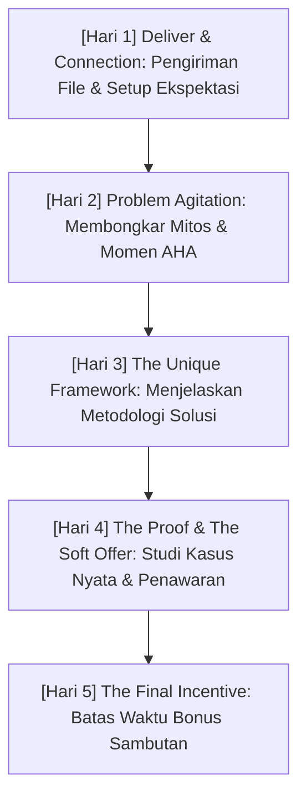

Saat seseorang mengunduh *lead magnet* gratis Anda, mereka berada pada puncak rasa ingin tahu dan perhatian tertinggi terhadap solusi Anda. Rata-rata tingkat keterbukaan (*open rate*) email pertama berkisar antara **50% hingga 75%**, jauh lebih tinggi dibanding newsletter reguler yang biasanya berada di angka 20–25%.

Sayangnya, kebanyakan kreator melakukan salah satu dari dua blunder mematikan:
1. **Menghilang berpekan-pekan** setelah mengirim link unduhan gratis, sehingga ketika mereka akhirnya mengirim email promosi sebulan kemudian, audiens sudah lupa siapa mereka.
2. **Langsung mengirim hard-selling agresif** di email pertama dengan tombol "Beli Sekarang", yang seketika merusak rasa saling percaya.

Solusi elegan untuk mengatasi kedua kutub ekstrim ini adalah **The 5-Day Psychological Welcome Sequence**—rangkaian 5 email yang membawa subscriber dari orang asing menjadi pengagum karya Anda, dan akhirnya menjadi pembeli pertama.

---

## 1. Anatomi Emosional Alur Welcome Sequence 5 Hari

Berikut adalah pemetaan tujuan psikologis dari hari ke hari:

Mari kita bedah struktur dan formula penulisan untuk masing-masing hari:

---

## 2. Bedah Detail Hari demi Hari

### Hari 1: Deliver & Connection (Pengiriman & Penegasan Ekspektasi)
- **Tujuan Utama:** Mengirimkan aset yang dijanjikan seketika dan memastikan email Anda masuk ke inbox utama (*Primary tab*).
- **Subjek Email Contoh:** `[Download] Aset panduan Anda telah siap (+ 1 catatan penting)`
- **Poin Penting:**
  - Letakkan tautan unduhan langsung di paragraf awal (jangan sembunyikan di akhir).
  - Berikan pertanyaan sederhana di penutup: *"Apa tantangan terbesar Anda seputar [Topik] saat ini? Balas email ini ya, saya membaca setiap balasan secara pribadi."*
  - Membalas email melatih algoritma Gmail/Yahoo untuk menandai alamat Anda sebagai kontak penting, bukan folder promosi atau spam.

### Hari 2: The Core Problem & Epiphany (Membongkar Mitos & Momen AHA)
- **Tujuan Utama:** Menjelaskan mengapa cara lama yang dicoba audiens selalu gagal, bukan karena mereka bodoh, melainkan karena menggunakan pendekatan yang salah.
- **Subjek Email Contoh:** `Mengapa kerja keras 14 jam sehari justru menghambat penjualan Anda...`
- **Pola Cerita:** Ceritakan momen kegagalan masa lalu Anda saat masih mempercayai mitos umum, dan perubahan sudut pandang (*shift*) apa yang akhirnya membuka jalan keluar.

### Hari 3: The Framework (Memperkenalkan Metodologi Solusi)
- **Tujuan Utama:** Menjelaskan *APA* yang harus dilakukan (secara logis dan komprehensif) tanpa membuka seluruh langkah teknis *BAGAIMANA CARANYA* secara mendalam.
- **Subjek Email Contoh:** `Cetak biru 3 langkah yang kami gunakan untuk [Hasil Spesifik]`
- **Poin Penting:**
  - Berikan diagram atau tabel ringkas kerangka kerja Anda.
  - Tunjukkan bahwa mereka yang mencoba mengeksekusi sendiri tanpa panduan lengkap akan membutuhkan waktu 6–12 bulan trial-and-error.

### Hari 4: The Proof & The Soft Offer (Bukti Nyata & Penawaran Terbuka)
- **Tujuan Utama:** Memperkenalkan produk komersial Anda sebagai jalan pintas (*accelerator*) implementasi, didukung studi kasus pembeli sebelumnya.
- **Subjek Email Contoh:** `Bagaimana [Nama Klien] menghasilkan [Hasil] dalam 14 hari (studi kasus)`
- **Elemen Penawaran:**
  - Tunjukkan transformasi nyata dari kondisi sebelum menggunakan produk hingga kondisi sesudah.
  - Sambungkan ke tautan halaman produk di platform toko digital Anda.

### Hari 5: The Incentive Deadline (Urgensi Penawaran Spesial)
- **Tujuan Utama:** Mendorong audiens yang sudah berminat namun masih menunda untuk mengambil keputusan hari ini.
- **Subjek Email Contoh:** `[Tersisa 8 Jam] Akses bonus eksklusif sambutan Anda akan ditutup`
- **Poin Penting:**
  - Sertakan FAQ ringkas mengenai garansi, format materi, dan dukungan komunitas.
  - Tegaskan bahwa harga atau bonus pengantar ini hanya berlaku untuk subscriber baru dalam periode orientasi ini.

---

## 3. Matriks Perbandingan Efektivitas Copywriting Email

| Aspek Penilaian | Pola Hard-Sell Konvensional | Framework 5-Day Nurture Sequence |
| :--- | :--- | :--- |
| **Open Rate Rata-rata** | Merosot drastis setelah email ke-2 (<15%) | Stabil di kisaran 38% – 52% hingga hari ke-5 |
| **Unsubscribe Rate** | Tinggi (>2% per blast) | Rendah (<0.4%) karena kaya edukasi |
| **Kualitas Pembeli** | Pembeli impulsif yang rawan komplain | Pembeli teredukasi yang memahami nilai produk |
| **Rasio Konversi Prospek** | 0.5% – 1.2% | 2.5% – 4.8% dari total opt-in baru |

> **Catatan Strategis:**
> Jangan pernah merasa bersalah menjual produk Anda di Hari ke-4 dan Hari ke-5. Jika Anda benar-benar yakin produk digital Anda mampu memecahkan masalah mendalam mereka, menahannya justru merugikan calon pembeli Anda.

---

## Rangkuman & Langkah Selanjutnya

Welcome sequence 5 hari adalah jantung dari flywheel konversi evergreen. Ini adalah tenaga penjual otomatis terbaik yang tidak pernah lelah, tidak pernah cuti, dan selalu menyapa setiap prospek dengan nada bicara terbaik Anda.

Di **Bagian 3**, kita akan mempelajari cara mengimplementasikan **Dynamic Deadline & Urgensi Otentik**: bagaimana mengatur batas waktu yang adil tanpa menipu audiens dengan jam countdown palsu yang ter-reset saat halaman di-refresh.
