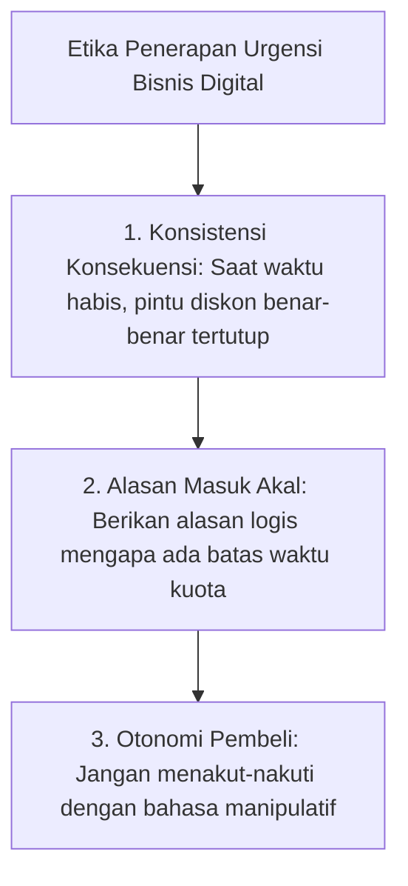

Pernahkah Anda mengunjungi landing page yang menampilkan timer merah berkedip: *"Penawaran berakhir dalam 00:14:32!"*—lalu saat Anda me-refresh browser atau membuka browser di jendela incognito, timer tersebut kembali menghitung mundur dari 15 menit?

Trik usang seperti ini tidak hanya merusak reputasi profesional Anda sebagai kreator, tetapi juga menghancurkan aset paling berharga dalam bisnis digital: **kepercayaan audiens**.

Audiens modern di era internet sangat cerdas. Sekali mereka menyadari bahwa urgensi yang Anda ciptakan adalah rekayasa bohong, mereka akan meragukan integritas seluruh materi dan rekomendasi yang Anda berikan.

Namun, fakta psikologi konsumen tetap tidak berubah: **manusia membutuhkan batas waktu (*deadline*) untuk mengatasi inersia menunda-nunda.**

Dalam artikel ini, kita akan membedah bagaimana menerapkan **Dynamic Urgency**—mekanisme urgensi dinamis yang sah, berbasis etika, dan benar-benar tertutup saat batas waktunya habis.

---

## 1. Tiga Prinsip Urgensi Etis dalam Bisnis Digital

Untuk menerapkan kelangkaan (*scarcity*) secara elegan, pegang teguh tiga kaidah moral berikut:

1. **Konsistensi Konsekuensi:** Jika Anda menyatakan bahwa harga promo Rp 199.000 hanya berlaku hingga Jumat pukul 23:59, maka pada Sabtu pukul 00:00 harga di halaman checkout wajib otomatis berubah menjadi harga normal (misal Rp 349.000). Jika seseorang yang terlambat tetap bisa membeli harga promo, Anda telah mengajarkan audiens untuk mengabaikan tenggat waktu Anda di masa mendatang.
2. **Alasan yang Masuk Akal (The Reason Why):** Jelaskan mengapa ada batas waktu. Contoh alasan etis:
   - *"Diskon ini adalah subsidi perkenalan khusus untuk anggota baru yang berkomitmen dalam 48 jam pertama."*
   - *"Bonus konsultasi 1-on-1 kami batasi untuk 15 pembeli pertama agar waktu pendampingan tetap berkualitas."*
3. **Menghormati Otonomi:** Jangan gunakan manipulasi emosional berlebihan seperti *"Kalau tidak beli sekarang, Anda selamanya akan miskin"*. Gunakan pendekatan profesional: *"Pilihan ada di tangan Anda. Jika Anda ingin menyelesaikan masalah ini lebih cepat dengan framework teruji, pintu kami terbuka hingga tengah malam nanti."*

---

## 2. Cara Kerja Dynamic Deadline Berbasis Prospek

Berbeda dengan kampanye live di mana semua orang memiliki satu tanggal akhir yang sama, pada sistem evergreen setiap individu memiliki **stempel waktu (timestamp)** unik saat mereka masuk ke database Anda.

| Komponen Alur | Cara Kerja Teknis | Pengalaman Pengguna (User Experience) |
| :--- | :--- | :--- |
| **Pemicu (Trigger)** | Prospek mengunduh lead magnet (Hari ke-0). | Pengguna menerima email konfirmasi seketika. |
| **Aktivasi Tenggat** | Hari ke-4 pukul 09:00 WIB, token link unik digenerate. | Pengguna mendapat tautan penawaran khusus berlaku 48 jam. |
| **Verifikasi Waktu** | Script mencocokkan waktu sekarang dengan `expired_at`. | Pengguna melihat countdown countdown akurat yang sinkron di semua perangkat. |
| **Pengalihan (Redirect)** | Setelah jam ke-48 lewat 1 detik. | Tautan otomatis dialihkan ke halaman harga reguler atau waitlist. |

> **Catatan Strategis:**
> Kunci dari dynamic deadline yang kredibel adalah **sinkronisasi multi-device**. Jika prospek membuka email di laptop atau di smartphone, batas waktu yang tersisa harus sama persis.

---

## 3. Menghadapi Calon Pembeli yang Melewatkan Batas Waktu

Salah satu ujian integritas terbesar seorang pengusaha digital adalah ketika seorang prospek mengirim pesan WhatsApp:
> *"Kak, saya kemarin di luar kota dan baru sempat buka email hari ini. Boleh minta harga promo sambutan kemarin?"*

Bagaimana meresponsnya?
- ❌ **Cara Salah:** *"Boleh kak, khusus buat kakak saya kasih harga kemarin ya."* (Ini menghancurkan wibawa batas waktu Anda).
- ✅ **Cara Elegan & Berprinsip:**
  > *"Halo Kak [Nama], terima kasih banyak sudah berminat! Mohon maaf sekali, sistem promo orientasi kami terhubung otomatis dengan server dan kuota telah dikunci saat batas waktu berakhir kemarin malam. Namun kakak tetap bisa mendapatkan produk lengkap beserta seluruh materi utamanya melalui tautan halaman reguler kami di sini: [Link Produk]. Nilai materi di dalamnya tetap jauh melampaui investasi yang kakak keluarkan."*

Sebagian besar prospek yang serius justru akan semakin menaruh hormat pada profesionalitas Anda dan tetap melakukan transaksi!

---

## Rangkuman & Langkah Selanjutnya

Urgensi bukanlah trik manipulasi, melainkan layanan empati untuk membantu calon pembeli Anda keluar dari kelumpuhan analisis (*analysis paralysis*).

Di **Bagian 4**, kita akan mengupas integrasi **WhatsApp Automation Engine** untuk pasar lokal Indonesia: bagaimana mengawinkan email funnel dengan pesan WhatsApp otomatis untuk meningkatkan rasio penyelesaian invoice hingga 300%.
