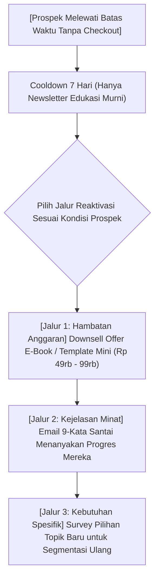

Dalam funnel penjualan evergreen terbaik di dunia sekalipun, angka konversi rata-rata berada di kisaran **3% hingga 7%**. Artinya, dari setiap 100 orang yang mengunduh magnet prospek dan membaca email Anda, ada **93 hingga 97 orang yang memilih untuk TIDAK membeli** penawaran pertama Anda.

Sebagian besar kreator menganggap 95% orang tersebut sebagai "kegagalan" dan membiarkan kontak mereka mengendap pasif menjadi database mati.

Ini adalah pemborosan aset bisnis digital terbesar. 

Seseorang yang tidak membeli produk Rp 500.000 hari ini bukan berarti mereka membenci Anda. Alasan mereka belum membeli biasanya terbagi menjadi 3 kemungkinan:
1. **Timing belum tepat:** Mereka sedang sibuk ujian, liburan, atau dana bulanan baru cair di akhir bulan.
2. **Hambatan harga (Budget constraint):** Mereka butuh solusi, tapi belum memiliki anggaran sebesar harga produk utama Anda.
3. **Format tidak sesuai:** Mereka tidak punya waktu menonton video course 10 jam, melainkan hanya butuh template spreadsheet yang langsung bisa dipakai dalam 5 menit.

Dalam bagian penutup dari seri *Sistem Penjualan Evergreen & Otomasi Funnel* ini, kita akan membedah strategi mereaktivasi database dan memaksimalkan **Customer Lifetime Value (LTV)**.

---

## 1. Tiga Kampanye Penyelamat Database Pasif

Jangan biarkan prospek yang belum membeli tertidur. Masukkan mereka ke dalam tiga alur kerja pemulihan berikut:

Mari kita telaah satu per satu:

---

## 2. Bedah Strategi Reaktivasi & Monetisasi Berkelanjutan

### 1. Strategi Downsell (Menawarkan Solusi Kompak dengan Harga Lebih Terjangkau)
Jika produk utama Anda adalah masterclass video komprehensif seharga Rp 499.000, tawarkan versi ringkas atau aset intinya (misalnya: *Cheat Sheet + Kumpulan Template Siap Pakai*) seharga Rp 79.000.

**Mengapa ini sangat efektif?**
- Membeli produk berbayar pertama kali—berapa pun nilainya—mengubah identitas psikologis seseorang dari *"pencari gratisan"* (*freebie seeker*) menjadi *"pelanggan resmi"* (*paying customer*).
- Sekali mereka puas dengan kualitas template murah Anda, kemungkinan mereka meng-upgrade ke masterclass utama di kemudian hari meningkat hingga **400%**.

### 2. Formula Email 9-Kata Dean Jackson (The 9-Word Re-engagement Email)
Tiga minggu setelah batas waktu penawaran berakhir, kirim email yang sangat pendek, polos (tanpa banner gambar), dan terdengar seperti pesan dari teman lama:

> **Subjek:** `halo {{nama}}`
> 
> *Halo {{nama}}, apakah kamu masih berencana untuk merilis produk digital pertamamu bulan ini?*
> 
> *Salam hangat,*  
> *[Nama Anda]*

Email jenis ini menghasilkan persentase balasan (*reply rate*) luar biasa tinggi (sering kali di atas 25%) karena terasa sangat manusiawi dan membuka percakapan personal yang natural.

### 3. Kampanye Flash Sale Khusus Hari Gajian (Payday Boost)
Di Indonesia, siklus daya beli masyarakat mencapai puncaknya pada tanggal **25 hingga 1** setiap bulan. 

Manfaatkan momen ini dengan merilis kampanye flash sale 48 jam bertema *"Payday Special"* khusus untuk database non-pembeli Anda, memberikan kupon diskon tambahan atau bonus eksklusif terbatas.

---

## 3. Matriks Ekosistem LTV Produk Digital Mandiri

Kreator yang sukses secara finansial bukan yang memiliki satu produk lalu terus-menerus mencari orang baru, melainkan yang membangun **tangga nilai (value ladder)** berjenjang:

| Tingkatan Nilai | Jenis Penawaran | Target Harga | Peran Finansial |
| :--- | :--- | :--- | :--- |
| **Tier 0: Magnet** | Checklist / PDF / Mini Guide | Gratis (Tukar Kontak) | Mengumpulkan audiens berkualitas tinggi |
| **Tier 1: Tripwire / Downsell** | Template Spreadsheet / Prompt / E-book | Rp 39.000 – Rp 99.000 | Menutupi biaya operasional & menyaring pembeli |
| **Tier 2: Core Offer (Evergreen)** | Video Masterclass / Framework Lengkap | Rp 299.000 – Rp 799.000 | Mesin pendapatan utama bisnis harian |
| **Tier 3: High-Ticket / VIP** | Sesi Audit 1-on-1 / Akses Komunitas Eksklusif | Rp 1.500.000 – Rp 5.000.000+ | Sumber margin laba bersih tertinggi |

> **Catatan Strategis:**
> Dengan ekosistem tangga nilai yang solid di platform [SitusBisnis](https://situsbisnis.com), Anda tidak lagi terobsesi dengan berapa banyak followers media sosial Anda. Bahkan dengan 1.000 subscriber email aktif, Anda dapat menjalankan bisnis digital mandiri beromzet puluhan juta rupiah setiap bulannya.

---

## Catatan Penutup Buat Kamu

Membangun funnel evergreen bukan tentang mencari trik sulap buat kaya mendadak, melainkan tentang **menghargai waktu dan energimu sebagai kreator**.

Dengan sistem yang menyambut subscriber baru, membangun kedekatan lewat cerita, memberikan penawaran terbatas yang etis, serta notifikasi WhatsApp otomatis di [SitusBisnis](https://situsbisnis.com)... kamu tidak lagi tertekan oleh siklus peluncuran musiman yang bikin stres.

Bisnismu bisa terus melayani dan menghasilkan cuan setiap hari, sementara kamu bisa fokus berkarya dan menikmati hidup dengan tenang!
