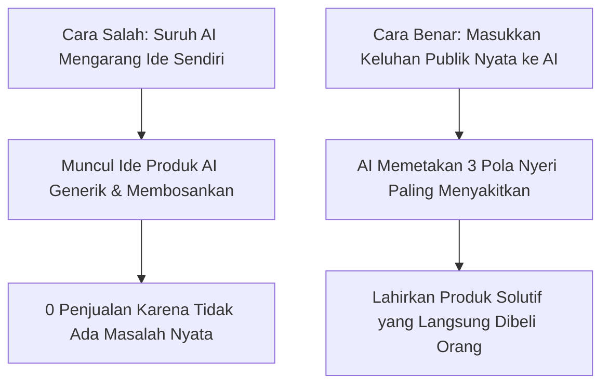
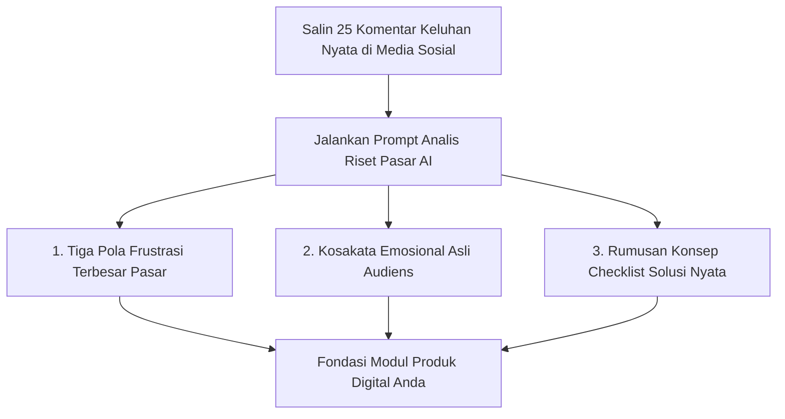

Bekerja sendirian (*solopreneur*) itu serba dilematis: di satu sisi Anda punya kebebasan penuh, tapi di sisi lain semua urusan—mulai dari riset, bikin materi, susun naskah jualan, sampai balas pesan pembeli—harus Anda tanggung sendiri. Wajar kalau banyak yang kelelahan dan menyerah bahkan sebelum sempat meluncurkan produk pertamanya.

Di era sekarang, kecerdasan buatan (AI) memang bisa jadi asisten tangguh pengganti tim kerja. Tapi celakanya, 9 dari 10 pemula memakai AI dengan cara yang keliru: **menyuruh AI mengarang ide produk dari nol**. Hasilnya? Lahir produk digital hambar, klise, dan tidak ada yang mau beli karena tidak memecahkan masalah siapa pun.

Di artikel pembuka seri *Solopreneur AI Playbook* ini, kita tinggalkan janji muluk kaya mendadak. Kita akan membedah alur kerja taktis: bagaimana memanfaatkan AI bukan untuk berkhayal, melainkan sebagai **mesin analis data untuk memetakan keluhan riil calon pembeli langsung dari lapangan**.

AI seharusnya tidak dipakai untuk berimajinasi, melainkan dipakai sebagai **mesin analis data riset untuk menggali keluhan nyata audiens dari dunia nyata**.

## Cara Menemukan Data Mentah Keluhan Pasar Lokal

Sebelum membuka ChatGPT, Claude, atau Gemini, cari data mentah dari tempat orang Indonesia menumpahkan keluhan jujur mereka:
1. **Kolom Komentar TikTok / Instagram**: Cari video viral di niche Anda (misal tentang mengurus izin usaha atau tips diet), lalu baca komentar teratas yang diawali kata *"Tapi kak...", "Paling pusing pas bagian...", "Gimana caranya kalau..."*.
2. **Review Bintang 1 dan 2 di Toko Buku Online / E-commerce**: Cari buku atau kursus terlaris di niche Anda, lalu baca keluhan pembeli yang kecewa. Di sanalah letak celah yang belum diselesaikan kompetitor Anda!
3. **Grup Diskusi Facebook & Quora Indonesia**: Cari pertanyaan yang berulang kali ditanyakan oleh orang yang berbeda.

Salin 20 hingga 30 komentar keluhan tersebut ke satu dokumen teks catatan.

## Prompt Perumus Pola Nyeri Audiens (Pain Point Extractor)

Setelah Anda mengumpulkan data keluhan riil, buka AI Anda dan gunakan struktur perintah (*prompt*) berikut:

> *"Bertindaklah sebagai Konsultan Riset Pasar Senior untuk konsumen Indonesia. Saya lampirkan 25 komentar keluhan riil dari calon pembeli potensial di bidang [Sebutkan Niche Anda, misal: Pemilik Warung Kopi Pemula].*
>
> *Tugas Anda:*
> 1. *Kelompokkan 25 komentar ini ke dalam 3 masalah utama yang paling menyita waktu atau menguras uang mereka.*
> 2. *Tuliskan kata-kata emosional atau frasa frustrasi yang paling sering mereka ulang.*
> 3. *Rumuskan 1 ide dokumen panduan praktis (checklist/spreadsheet) 5 halaman yang bisa langsung menyelesaikan masalah nomor 1.*
> 
> *Berikut data komentarnya:*
> *[Tempelkan 25 komentar tadi]*"*

## Mengapa Pendekatan Ini 100 Kali Lebih Berhasil?

Dengan metode ini:
- Anda tidak perlu menebak-nebak apa yang diinginkan pasar.
- Produk Anda langsung menggunakan **bahasa asli calon pembeli**, bukan bahasa teoritis yang kaku.
- Anda memangkas waktu riset pasar dari yang biasanya butuh 2 minggu menjadi hanya **30 menit**.

Di bagian selanjutnya (**Part 2: Menyusun Draf Modul dan Lembar Kerja Tanpa Nada Robotik**), kita akan membahas teknik menyusun isi panduan menggunakan AI tanpa membuat materi Anda terdengar kaku seperti tulisan robot.
