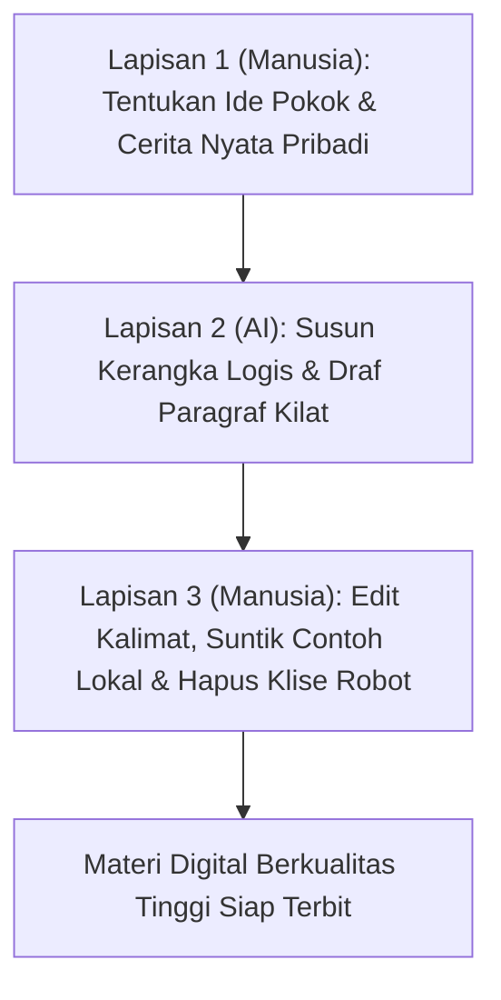
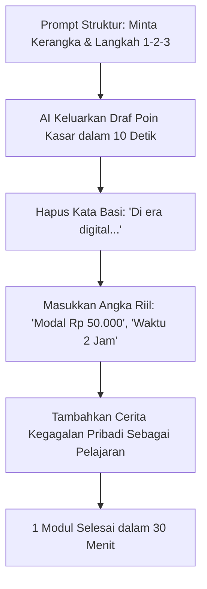

Pernahkah Anda membeli modul atau e-book digital, lalu baru membaca halaman pertama langsung membatin: *"Ah, ini sih seratus persen hasil copy-paste ChatGPT"*?

Ciri-cirinya selalu sama dan sangat mudah ditebak:
- Selalu dibuka kalimat basi: *"Di era digital yang berkembang pesat dan dinamis ini..."*
- Bertabur kata kaku terjemahan literal mesin: *"Melompat ke dalam kancah"*, *"Merupakan bukti nyata"*, atau *"Tak dapat dimungkiri"*.
- Ditutup ucapan selamat kelulusan aneh layaknya robot: *"Selamat! Anda kini telah siap menaklukkan dunia bisnis..."*

Materi seperti ini bukan cuma bikin pembeli merasa tertipu, tapi juga merusak reputasi nama Anda seketika. Pembeli tidak membayar untuk teks terjemahan mesin—mereka membayar untuk empati, sudut pandang personal, dan solusi nyata yang bisa langsung dipraktikkan.

Setelah di [bagian pertama](/posts/solopreneur-ai-part-1-riset-masalah-dan-kurasi-pengetahuan/) kita berhasil memetakan pola keluhan riil audiens, kini saatnya masuk ke dapur produksi: **cara menulis modul dan lembar kerja kilat memakai AI tanpa kehilangan jiwa manusia dan sentuhan lokal**.

Kuncinya ada pada **Metode Penulisan Sandwich (*The Human-AI Sandwich Method*)**: AI bertugas menyiapkan kerangka dan draf mentah berkecepatan tinggi, sementara manusia bertugas menyuntikkan cerita nyata, angka riil, dan kearifan lokal.

## 3 Aturan Emas Menghilangkan Nada Robotik

Saat meminta AI menulis draf penjelasan, tambahkan batasan gaya bahasa (*style guardrails*) berikut di prompt Anda:

1. **Larang Klise Pembuka**: Beri instruksi tegas: *"Dilarang memulai paragraf dengan kalimat 'Di era modern/digital saat ini' atau 'Penting untuk diingat bahwa'. Langsung mulai dengan masalah konkret."*
2. **Gunakan Kalimat Pendek dan Aktif**: Instruksikan: *"Gunakan bahasa Indonesia percakapan semi-formal yang lugas, kalimat pendek maksimal 15 kata per kalimat, dan gunakan kata 'Anda' sebagai sapaan pembaca."*
3. **Wajibkan Format Tabel atau Checklist**: Jangan biarkan AI menghasilkan dinding teks panjang yang melelahkan mata. Mintalah tabel perbandingan atau poin checklist berurutan.

## Contoh Eksekusi Nyata: Mengubah Draf Robot Jadi Draf Bernyawa

Perhatikan perbedaan hasil sebelum dan sesudah sentuhan manusia pada materi pengelolaan kas usaha kecil:

### Draf Asli AI Mentah (Kaku & Teoretis)
> *"Pengelolaan likuiditas keuangan merupakan tonggak fundamental bagi entitas usaha mikro. Di era volatilitas pasar saat ini, pelaku usaha wajib senantiasa memantau arus kas masuk dan arus kas keluar guna memitigasi risiko kebangkrutan yang tak terduga."*

### Draf Hasil Metode Sandwich (Membumi & Langsung Aksi)
> *"Banyak pemilik warung makan merasa omzetnya ramai setiap hari, tapi pas akhir bulan uang di rekening habis tak bersisa. Masalahnya bukan karena makanan Anda sepi, melainkan karena Anda mencampur uang belanja dapur rumah dengan uang kas kasir warung. Sebelum belanja bahan besok subuh, pisahkan 2 rekening bank sekarang juga."*

Perhatikan bedanya: versi kedua berbicara langsung ke titik sakit pembaca, menggunakan bahasa sehari-hari, dan memberikan instruksi aksi nyata dalam waktu 5 detik.

## Lembar Kerja Pendamping yang Melipatgandakan Nilai

Jangan hanya memberikan materi teks bacaan. Buat lembar kerja (*actionable worksheet*) di akhir setiap bab:
- Tabel evaluasi mandiri (*Self-Audit Checklist*).
- Naskah siap salin (*Plug-and-Play Script*).

Di bagian berikutnya (**Part 3: Otomasi Saluran Promosi dan Naskah Penjualan dalam 1 Jam**), kita akan menggunakan AI untuk merumuskan landing page penawaran dan naskah pesan penutup penjualan dalam waktu kurang dari 60 menit.
