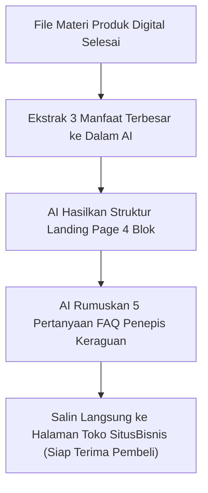
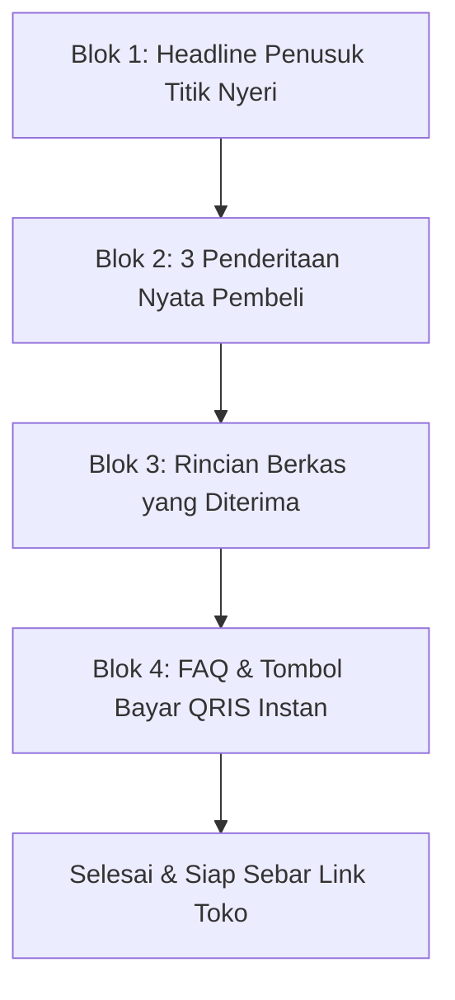

Menatap kursor berkedip-kedip di layar monitor yang masih kosong melompong adalah momen paling menyiksa bagi siapa pun yang bersiap meluncurkan produk digital.

Modul dan lembar kerja sudah rapi kita susun di [panduan kedua](/posts/solopreneur-ai-part-2-menyusun-draf-modul-anti-robot/), berkas sudah siap dibagikan, tapi tiba-tiba langkah Anda terhenti di depan dinding tebal bernama *copywriting paralysis*:
- Judul halamannya harus ditulis bagaimana biar tidak terdengar murahan?
- Deskripsi fiturnya kepanjangan atau malah bikin bingung?
- Kalimat ajakan belinya (*CTA*) harus dirancang seperti apa agar calon pembeli mantap memindai QRIS?

Akibat keraguan ini, peluncuran produk yang semestinya beres dalam hitungan jam malah tertunda berminggu-minggu.

Kabar baiknya: Anda tidak perlu kursus menulis naskah iklan bertahun-tahun hanya untuk merancang halaman penjualan yang menghasilkan konversi. Di artikel ketiga seri *Solopreneur AI Playbook* ini, kita akan merangkai seluruh aset penawaran—mulai dari struktur landing page ringkas 4 blok, daftar FAQ penepis keraguan, hingga 3 variasi naskah promosi media sosial—**selesai tuntas dalam waktu kurang dari 60 menit** menggunakan AI yang terarah.

## Rumus 4 Blok Landing Page Efektif

Halaman penjualan produk digital tidak butuh desain yang bertele-tele. Cukup gunakan struktur 4 blok:

### Blok 1: Headline Hook & Janji Utama
Judul utama yang langsung menusuk masalah pembeli dan menyebutkan hasil akhir dalam hitungan jam/hari:
- *Contoh*: *"Bereskan Izin Edar PIRT Produk Kuliner Anda Tanpa Perlu Calo dan Tanpa Bolak-Balik Ditolak Dinas."*

### Blok 2: Daftar Nyeri yang Bikin Frustrasi
Deskripsikan 3 penderitaan yang sedang dialami pembeli agar mereka merasa sangat dipahami:
- *"Apakah Anda lelah bolak-balik ke kantor dinas hanya karena format label salah ukuran?"*
- *"Bingung cari contoh surat pernyataan higienitas sanitasi yang sesuai standar resmi?"*

### Blok 3: Apa yang Ada di Dalam File (The Breakdown)
Rincian dokumen yang diterima pembeli dalam bentuk poin checklist:
- Modul 1: Checklist Berkas Wajib Lolos Verifikasi Pertama.
- Modul 2: Template Surat Pernyataan Siap Pakai (Tinggal Ganti Nama).
- Modul 3: Rekaman Video 10 Menit Tutorial Pengisian Portal Resmi.

### Blok 4: FAQ Penepis Keraguan & Tombol Checkout Instan
Jawab 3 ketakutan terbesar calon pembeli:
- *"Saya gaptek, apakah dokumen ini mudah dipahami?"*
- *"Format file apa yang saya terima?"*
- *"Bagaimana cara pembayarannya?"*

## Prompt Pembuat Landing Page 1 Halaman Siap Pasang

Salin dan gunakan prompt berikut di AI Anda:

> *"Saya memiliki produk digital berupa dokumen panduan dan checklist PDF untuk membantu [Sebutkan Target Pembeli] agar bisa [Sebutkan Hasil Utama]. Harganya adalah Rp [Sebutkan Harga, misal: 49.000].*
>
> *Tugas Anda: Buat naskah landing page 1 halaman dengan 4 blok:*
> 1. *Tiga alternatif headline hook yang provokatif dan ramah.*
> 2. *Tiga paragraf pendek yang menggambarkan rasa frustrasi mereka saat ini.*
> 3. *Daftar 4 komponen isi produk dengan bahasa yang menonjolkan manfaat (bukan teknis).*
> 4. *Empat pertanyaan FAQ yang paling sering ditakutkan pembeli awam beserta jawaban yang menenangkan hati.*
>
> *Gaya bahasa: Percakapan santai, empatik, to the point, tanpa kata-kata klise robotik."*

Dalam waktu 30 detik, AI akan menyajikan naskah lengkap yang siap Anda salin ke halaman toko Anda.

## Pasang Langsung ke Toko Mandiri Anda

Anda tidak perlu menyewa desainer web atau membeli plugin WordPress yang rumit. 

Cukup buka dasbor [SitusBisnis](https://situsbisnis.com), tempelkan naskah hasil kurasi AI tadi ke kolom deskripsi produk, pasang harga Rp 49.000, lalu simpan. Halaman checkout profesional Anda langsung aktif dan siap menerima pembayaran QRIS instan dari seluruh penjuru Indonesia.

Di bagian penutup (**Part 4: Sistem Customer Service dan FAQ Otomatis 24 Jam Nonstop**), kita akan membahas bagaimana menangani kendala teknis pembeli secara otomatis sehingga toko digital Anda tetap berjalan lancar saat Anda sedang beristirahat.
