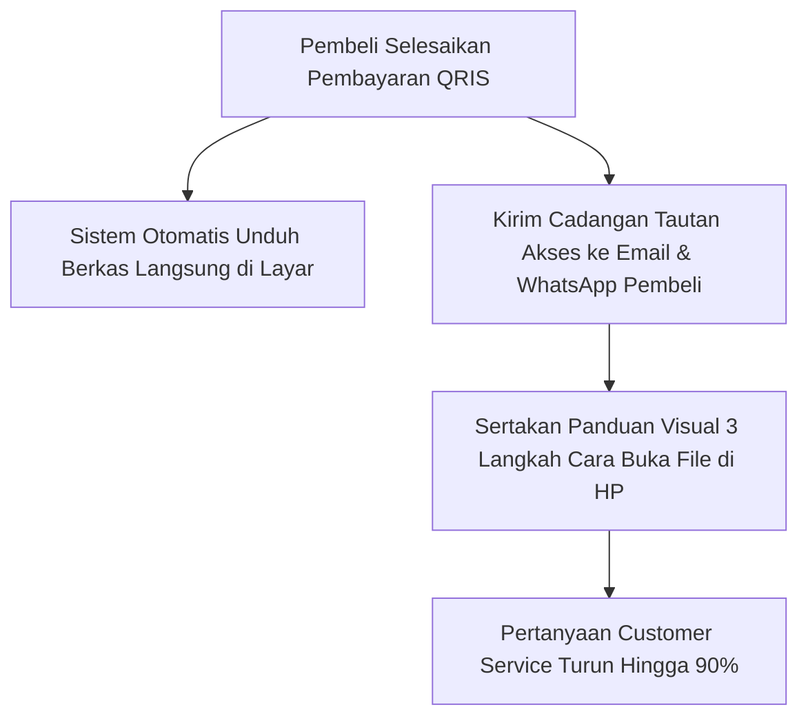
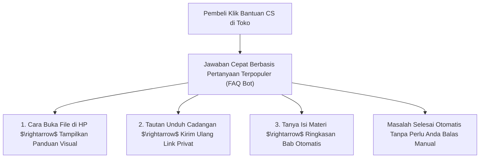

Bayangkan skenario ini: toko digital Anda akhirnya mulai mendatangkan penjualan rutin setiap hari, tapi ponsel Anda tidak pernah berhenti bergetar. Tepat pukul 01.30 dini hari, ada notifikasi WhatsApp masuk:

- *"Kak, saya barusan bayar lewat QRIS tapi kok link unduhnya tidak muncul ya?"*
- *"Kak, file panduannya tidak bisa dibuka di HP iPhone saya, gimana solusinya?"*
- *"Bisa transfer manual ke rekening BCA saja tidak Kak?"*

Kalau setiap hari Anda harus meladeni pertanyaan serupa puluhan kali secara manual, impian membangun penghasilan otomatis justru berubah menjadi jeratan pekerjaan shift malam yang menyita waktu tidur Anda.

Di [bagian ketiga](/posts/solopreneur-ai-part-3-otomasi-promosi-dan-landing-page-1-jam/), halaman penawaran sudah aktif dan siap mendatangkan transaksi. Kini, di bagian penutup seri *Solopreneur AI Playbook*, kita akan mengunci mata rantai operasional terakhir: **membangun sistem FAQ proaktif dan pengiriman berkas otomatis 24 jam nonstop** agar pembeli terlayani tuntas dalam hitungan detik tanpa Anda harus terus-menerus memelototi layar HP.

Kuncinya adalah membangun **Sistem FAQ Proaktif dan Otomasi Pengiriman Berkas** yang menjawab masalah pembeli sebelum mereka sempat bertanya.

## Membedah 3 Pertanyaan yang Menyumbang 90% Chat CS

Setelah menganalisis ribuan transaksi produk digital di Indonesia, 9 dari 10 pertanyaan pembeli sebenarnya hanya berkisar pada 3 hal:

### 1. Masalah Tautan Unduh Hilang atau Terlewat
Pembeli yang terburu-buru menutup layar browser setelah memindai QRIS sering lupa mengklik tombol unduh.
- **Solusi Otomatis**: Gunakan platform toko yang secara otomatis mengirimkan tautan akses cadangan ke WhatsApp atau email pembeli tepat di detik pembayaran terverifikasi.

### 2. Masalah Format File di Ponsel (Khususnya Pengguna iPhone/Android Tertentu)
Pembeli awam sering tidak tahu cara membuka file arsip `.zip` atau spreadsheet `.xlsx` di ponsel mereka.
- **Solusi Otomatis**: Buat 1 gambar infografis ringkas ukuran 1:1 berjudul *"Panduan 3 Langkah Membuka File Ini di HP"*:
  1. Untuk pengguna Android: Buka aplikasi Files bawaan HP.
  2. Untuk pengguna iPhone: Buka aplikasi Files $\rightarrow$ Downloads.
  3. Buka tautan Google Drive cadangan jika memori HP penuh.
- Lampirkan infografis ini di email konfirmasi pesanan.

### 3. Konfirmasi Status Pembayaran
Pembeli cemas apakah pembayaran QRIS mereka sudah masuk ke sistem toko.
- **Solusi Otomatis**: Sistem pembayaran instan SitusBisnis secara otomatis mengubah tampilan layar dari barcode QRIS menjadi tanda centang hijau *"Pembayaran Berhasil Diverifikasi"* dalam waktu 1 detik tanpa perlu kirim bukti struk transfer.

## Prompt Pembuat Basis Data FAQ Pintar (Smart Support Knowledgebase)

Gunakan prompt ini di AI Anda untuk menyiapkan seluruh materi layanan pelanggan otomatis:

> *"Saya menjual produk digital berupa [Sebutkan Nama Produk dan Format Berkasnya]. Pembeli saya adalah orang Indonesia awam yang menggunakan ponsel Android dan iPhone.*
>
> *Tugas Anda: Buat naskah pesan layanan pelanggan siap pakai untuk 4 situasi berikut:*
> 1. *Pesan konfirmasi pesanan ramah via WhatsApp yang menyertakan tautan unduh cadangan dan panduan buka file.*
> 2. *Jawaban cepat jika pembeli komplain 'Link unduh tidak bisa diklik'.*
> 3. *Jawaban sopan jika ada pembeli yang meminta metode pembayaran di luar QRIS/Virtual Account.*
> 4. *Pesan tindak lanjut hari ke-3 untuk meminta ulasan dan kepuasan pemakaian.*
>
> *Format: Naskah pesan pendek siap salin dengan tanda kurung [Variabel] yang mudah disesuaikan."*

Simpan naskah jawaban cepat ini di fitur *Quick Replies* WhatsApp Business atau papan klip (*clipboard*) ponsel Anda. Saat ada yang bertanya, Anda cukup mengetik pintasan `/bantuan` dan pesan lengkap terkirim dalam 2 detik.

## Ekosistem Mandiri: Kebebasan Sejati Seorang Solopreneur

Tujuan Anda membangun bisnis produk digital bukan untuk menciptakan majikan baru, melainkan untuk **membeli kembali waktu dan kebebasan hidup Anda**.

Dengan menggabungkan:
- Riset masalah nyata berbantuan AI ([Part 1](/posts/solopreneur-ai-part-1-riset-masalah-dan-kurasi-pengetahuan/)),
- Penulisan materi berempati bebas nada robot ([Part 2](/posts/solopreneur-ai-part-2-menyusun-draf-modul-anti-robot/)),
- Landing page penawaran kilat ([Part 3](/posts/solopreneur-ai-part-3-otomasi-promosi-dan-landing-page-1-jam/)),
- Serta toko mandiri tanpa potongan komisi di [SitusBisnis](https://situsbisnis.com) dengan sistem pengiriman otomatis ([Part 4](/posts/solopreneur-ai-part-4-sistem-customer-service-dan-faq-otomatis/)),

Anda telah resmi memiliki **mesin bisnis digital mandiri yang bekerja tanpa henti 24 jam sehari, 7 hari seminggu**, menghasilkan arus kas bersih yang seutuhnya menjadi hak Anda.

---

### Rangkuman Seri Solopreneur AI Playbook
1. **[Part 1: Riset Masalah & Kurasi Pengetahuan](/posts/solopreneur-ai-part-1-riset-masalah-dan-kurasi-pengetahuan/)**: Bongkar keluhan nyata pasar dari media sosial tanpa menebak isi kepala audiens.
2. **[Part 2: Menyusun Draf Modul Anti-Robot](/posts/solopreneur-ai-part-2-menyusun-draf-modul-anti-robot/)**: Metode sandwich yang memadukan kecepatan AI dengan kehangatan cerita lokal.
3. **[Part 3: Otomasi Promosi & Landing Page 1 Jam](/posts/solopreneur-ai-part-3-otomasi-promosi-dan-landing-page-1-jam/)**: Struktur penawaran 4 blok dan prompt copywriting bebas buntu ide.
4. **[Part 4: Sistem Customer Service & FAQ Otomatis](/posts/solopreneur-ai-part-4-sistem-customer-service-dan-faq-otomatis/)**: Protokol pengiriman proaktif dan quick replies untuk membebaskan waktu istirahat Anda.
