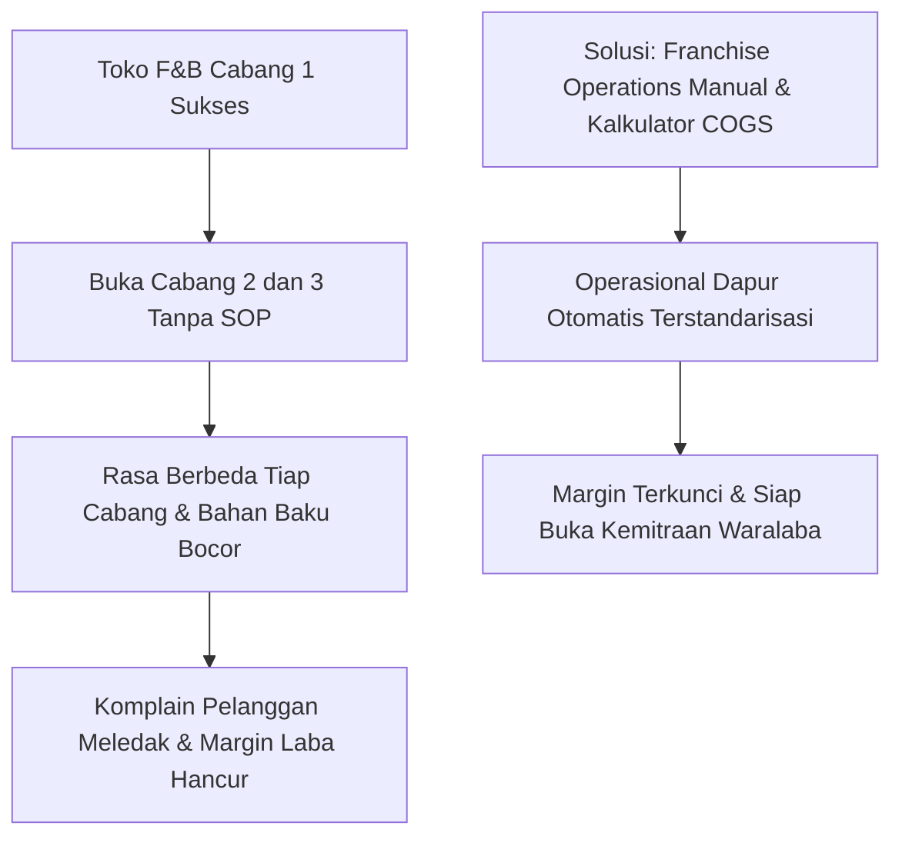
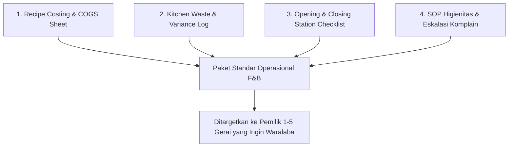

Industri Food & Beverage (F&B) di Indonesia adalah salah satu pasar paling dinamis sekaligus paling kejam. Ratusan kafe, kedai kopi, dan gerai ayam goreng buka setiap bulan, tetapi lebih dari 60% gulung tikar dalam tahun pertama.

Penyebab kematian terbesarnya bukan karena rasa makanan yang tidak enak, melainkan **kebocoran operasional di dapur, pemborosan bahan baku (*waste*), dan inkonsistensi rasa saat membuka cabang baru**.

Kondisi ini menciptakan peluang bisnis digital bernilai tinggi bagi siapa saja yang memiliki pengalaman mengelola restoran atau dapur komersial: **menjual Paket Standarisasi Operasional F&B Siap Pakai**.

## Anatomi Aset Operasional F&B yang Bernilai Jutaan

Pemilik kedai kopi atau warung makan yang ingin berekspansi menjadi waralaba sering tidak punya waktu untuk menulis SOP dari nol. Dokumen yang paling mereka butuhkan mencakup empat pilar utama:

### 1. Kalkulator COGS Dinamis Berbasis Gramatur (Recipe Costing Sheet)
Banyak pengusaha kuliner menentukan harga jual hanya dengan melihat harga kompetitor terdekat. Ini adalah resep menuju kebangkrutan.
- Aset spreadsheet yang menghitung biaya per gram/mililiter bumbu, protein, saus, hingga biaya kemasan (box, stiker, sendok kayu).
- Dilengkapi formula penyusutan bahan (*yield factor*) untuk daging atau sayuran yang menyusut saat dibersihkan dan dimasak.
- Simulasi margin laba bersih jika harga cabai atau minyak goreng di pasar naik 20%.

### 2. Lembar Kontrol Kebocoran Dapur (Kitchen Waste Log)
Kebocoran margin terbesar di bisnis restoran bukan dari biaya sewa ruko, melainkan makanan basi, porsi kebesaran karena takaran tidak standar, atau bahan yang rusak di gudang.
- Log harian pencatatan bahan yang dibuang beserta alasannya (gosong, kedaluwarsa, tumpah).
- Formula audit stok fisik vs catatan penjualan di sistem kasir POS (*variance analysis*).

### 3. SOP Pembukaan dan Penutupan Toko (Opening & Closing Checklist)
Daftar periksa checklist visual untuk staf operasional:
- Cek suhu chiller dan freezer setiap pagi dan malam.
- Prosedur sanitasi area potong daging dan penggantian minyak goreng.
- Kalibrasi grinder kopi dan pembersihan steam wand mesin espresso.

### 4. Matriks Eskalasi Komplain Pelanggan (Customer Complaint Resolution)
Panduan tindakan cepat saat pelanggan menemukan benda asing di makanan, pesanan salah, atau pelayanan terlambat:
- Skrip komunikasi yang wajib dan dilarang diucapkan staf kasir.
- Batasan kompensasi gratis (voucher/ganti menu) tanpa perlu menunggu persetujuan pemilik toko.

## Angka Riil: Mengapa Harga Rp 1.500.000 Terlihat Sangat Murah?

Bayangkan seorang pemilik 2 gerai mie pedas yang kehilangan rata-rata Rp 150.000 per hari di setiap cabang akibat bahan baku tumpah, porsi berlebih, dan pencatatan kasir yang meleset.

Dalam satu bulan, kebocoran tersebut mencapai:
$$\text{Kebocoran Kas} = 2 \times \text{Rp } 150.000 \times 30 = \text{Rp } 9.000.000$$

Membayar Rp 1.500.000 satu kali untuk mendapatkan bundel SOP dan kalkulator audit yang langsung menghentikan kebocoran Rp 9 juta per bulan adalah keputusan bisnis yang sangat mudah diambil oleh pemilik gerai.

## Cara Mengemas dan Mendistribusikan Aset F&B

1. **Format File Hybrid**: Sediakan format Google Docs/Word untuk SOP tertulis agar mudah diedit nama mereknya, serta Google Sheets/Excel untuk kalkulator COGS dengan proteksi formula agar tidak rusak terhapus oleh staf pemula.
2. **Sertakan Formulir Cetak Laminasi (Printable Station Cards)**: Buat kartu panduan ringkas ukuran A5 yang siap dicetak dan dilaminasi untuk ditempel di dinding dapur di atas meja kerja juru masak.
3. **Landing Page Berfokus Masalah Keuangan**: Jangan jual "dokumen". Jual "cara mengunci margin laba 35% dan mencegah karyawan dapur mencuri bahan baku".

Dengan menjual langsung melalui platform mandiri seperti [SitusBisnis](https://situsbisnis.com), Anda bisa mengirimkan tautan akses Google Drive privat secara otomatis begitu pemilik gerai melunasi transaksi via QRIS kasir mereka, tanpa terpotong komisi sepeser pun.
