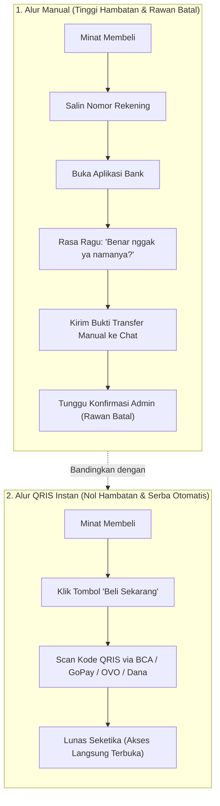

Coba ingat-ingat, pernah nggak kamu mau beli barang di olshop lewat chat WhatsApp, tapi alur pembayarannya seperti ini:
1. Kamu tanya harga: *"Kak ini berapa ya?"*
2. Penjual balas 2 jam kemudian: *"Rp 150.000 kak, mau BCA atau Mandiri?"*
3. Kamu jawab: *"BCA kak."*
4. Penjual kirim nomor rekening panjang tanpa spasi: `BCA 8271928391 a.n. Budi Santoso`.
5. Kamu harus salin nomornya, buka aplikasi m-banking, input nomor baru, cek nama, masukin PIN, transfer, lalu... **harus screenshot bukti transfer dan kirim balik ke penjual**.
6. Terus kamu nunggu lagi si penjual ngecek mutasi manual di HP-nya.

Jujur, melelahkan banget kan? 

Dan di era sekarang di mana orang serba buru-buru, **setiap langkah ekstra yang kamu bebankan ke calon pembeli akan memangkas tingkat konversimu hingga 10% – 15% per langkah.**

Kalau kamu masih jualan pakai metode kirim nomor rekening manual seperti di atas, kamu sedang secara sukarela menyumbang puluhan pembeli potensial ke kompetitor yang checkout-nya lebih canggih.

Mari kita bahas kenapa QRIS dan checkout satu klik adalah standar mutlak bisnis digital modern di Indonesia!

---

## 1. Anatomi Friksi: Perjalanan Mental Pembeli Lokal

Mari kita intip apa yang ada di kepala pembelimu saat menghadapi alur pembayaran manual vs QRIS otomatis:

Di alur QRIS, pembeli tidak perlu menyalin nomor rekening, tidak perlu takut salah transfer ke orang lain, dan tidak perlu repot mengirim foto kuitansi struk. 

Semuanya beres dalam **3 detik**.

---

## 2. Tiga Kerugian Tersembunyi dari Cara Jualan Manual

Banyak penjual online bertahan dengan cara manual karena merasa *"kan gratis, nggak perlu bayar fee software"*. Padahal, "gratis" tersebut mengorbankan hal-hal yang jauh lebih mahal:

| Kerugian Tersembunyi | Dampak Nyata pada Bisnismu |
| :--- | :--- |
| **Tingkat Transaksi Batal (*Drop-Off*)** | Rata-rata 35% – 45% orang yang minta nomor rekening akhirnya nggak pernah transfer. |
| **Waktu Produktifmu Habis** | Menghabiskan 2–3 jam sehari cuma buat mencocokkan mutasi bank dan kirim link download satu per satu. |
| **Keterbatasan Skala Bisnis** | Kalau tokomu dapat 50 pesanan dalam sehari, kamu bakal kewalahan dan rentan salah kirim file ke pembeli yang salah. |

> **Catatan Buat Kamu:**
> Waktu 3 jam yang kamu habiskan buat cek mutasi rekening manual jauh lebih berguna kalau kamu pakai untuk bikin produk baru atau merancang strategi pemasaran berikutnya!

---

## 3. Gimana Cara Pasang Checkout QRIS Otomatis Tanpa Ribet?

Dulu, untuk punya QRIS statis atau dinamis yang terhubung ke sistem website, kamu harus:
- Punya badan hukum PT atau CV resmi.
- Melampirkan surat izin usaha dan NPWP perusahaan.
- Integrasi API payment gateway yang butuh programmer handal.

Tapi sekarang, ekosistem sudah jauh lebih ramah buat solopreneur mandiri. Dengan menggunakan platform toko seperti [SitusBisnis](https://situsbisnis.com):
1. Tokomu langsung siap menerima pembayaran **QRIS seluruh Indonesia** (BCA, Mandiri, BRI, BNI, GoPay, OVO, ShopeePay, Dana, LinkAja).
2. Sistem verifikasi pembayarannya berjalan otomatis 24 jam nonstop via gateway resmi Bank Indonesia.
3. Begitu scan QRIS sukses, file atau akses produkmu langsung meluncur otomatis ke email dan WhatsApp pembeli.
4. **Tanpa potongan komisi penjualan platform** (0% fee potongan toko).

---

## Jadikan Pembeli Nyaman, Omzet Pun Nyaman Mengalir

Ubah pola pikirmu: mempermudah cara bayar pembeli bukan sekadar urusan teknis, melainkan **bentuk penghormatan tertinggi pada waktu dan kenyamanan pelangganmu**.

Tinggalkan cara lama kirim no rekening manual di chat, aktifkan checkout instan tokomu hari ini, dan saksikan grafik penjualanmu melonjak naik!
