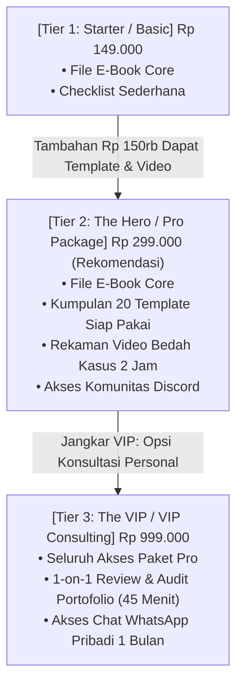

Ketika Anda hanya menjual satu produk dengan satu pilihan harga tetap (misal: *E-book seharga Rp 149.000*), Anda sebenarnya sedang meninggalkan banyak uang di atas meja.

Mengapa? Karena audiens Anda terbagi menjadi tiga kelompok daya beli dan tingkat kebutuhan yang berbeda:
1. **Kelompok Sadar Anggaran (Budget-Conscious):** Mereka hanya butuh solusi paling mendasar dengan biaya seringan mungkin.
2. **Kelompok Mayoritas Logis (The Mainstream Pragmatists):** Mereka menginginkan paket paling lengkap dengan nilai terbaik (*the best value for money*).
3. **Kelompok 'Do-It-For-Me' / VIP (Premium Buyers):** Sekitar 10% – 15% dari audiens Anda bersedia membayar 3x hingga 5x lipat lebih mahal asalkan mereka mendapatkan pendampingan personal, kecepatan ekstra, atau konsultasi langsung dengan Anda.

Dengan menerapkan strategi **Pricing Tiers (Penetapan Harga Bertingkat)**, Anda memberi kebebasan bagi masing-masing kelompok untuk memilih tingkat investasi mereka sendiri—sekaligus menggandakan **Average Order Value (AOV)** bisnis Anda secara signifikan.

---

## 1. Psikologi Anchoring: Efek Tiga Pilihan (Goldilocks Effect)

Otak manusia kesulitan menilai nilai absolut dari suatu barang tanpa adanya perbandingan. Inilah mengapa model penetapan 3 tier bekerja sangat ampuh:

Dalam skenario di atas:
- **Tier 3 (VIP)** bertindak sebagai jangkar (*price anchor*). Dengan melihat harga Rp 999.000, harga Tier 2 sebesar Rp 299.000 tiba-tiba terasa sangat masuk akal dan terjangkau!
- **Tier 1 (Starter)** bertindak sebagai pengingat bahwa jika mereka hanya menambah Rp 150.000 lagi, mereka bisa mendapatkan rekaman video, 20 template kerja, dan komunitas di **Tier 2**.
- Hasil riset perilaku konsumen: **60% hingga 75% pembeli akan secara alami memilih Tier 2 (Pro Package)**.

---

## 2. Cara Menyusun Isi Masing-Masing Tier Tanpa Menambah Beban Kerja Berlebih

Banyak kreator enggan membuat tingkatan paket karena takut harus membuat 3 produk berbeda dari nol. Padahal, rahasianya terletak pada **modifikasi aset pendukung**:

| Elemen Tingkatan Paket | Tier 1: Starter (Aset Murni) | Tier 2: Pro (Aset + Alat Kerja) | Tier 3: VIP (Aset + Interaksi Personal) |
| :--- | :--- | :--- | :--- |
| **Konten Dasar** | E-book / Panduan PDF Utama | E-book / Panduan PDF Utama | E-book / Panduan PDF Utama |
| **Alat Percepatan** | - | Template Spreadsheet / SOP / Dokumen Kerja | Template Spreadsheet / SOP / Dokumen Kerja |
| **Format Pembelajaran** | Teks mandiri | Teks + Rekaman Video Tutorial | Teks + Rekaman Video Tutorial |
| **Dukungan** | Tanpa support langsung | Komunitas grup sesama pembeli | Sesi tanya jawab / konsultasi personal |
| **Waktu Pembuatan Kreator** | 100% selesai di awal | Tambahan 2 hari (bikin template) | 0 jam tambahan aset (hanya alokasi waktu kalender) |

> **Catatan Strategis:**
> Batasi kuota untuk Tier 3 (VIP) secara ketat (misalnya: *Hanya tersedia 10 slot per bulan*). Hal ini menjaga kualitas pendampingan Anda sekaligus menciptakan kelangkaan alami yang memicu transaksi cepat.

---

## 3. Matematika Pertumbuhan Pendapatan: Model 1 Harga vs. Model 3 Tier

Mari kita hitung dampak finansial jika ada 100 orang pembeli:

### Skenario A: Hanya Menjual 1 Harga Tetap (Flat Model)
- 100 pembeli × Rp 149.000 = **Rp 14.900.000**
- *Average Order Value (AOV):* Rp 149.000

### Skenario B: Menjual dengan Model 3 Tier
- 20 pembeli memilih Tier Starter (Rp 149.000) = Rp 2.980.000
- 70 pembeli memilih Tier Pro (Rp 299.000) = Rp 20.930.000
- 10 pembeli memilih Tier VIP (Rp 999.000) = Rp 9.990.000
- **Total Omzet:** **Rp 33.900.000**
- *Average Order Value (AOV):* **Rp 339.000** (+127% kenaikan tanpa menambah jumlah pembeli baru!)

---

## 4. Cara Menampilkan Pricing Table yang Bersih dan Konversif

Saat mendesain tabel harga di platform Anda:
1. Berikan lencana visual yang menonjol pada paket pilihan utama: *"Paling Populer"* atau *"Pilihan Terbaik"*.
2. Beri warna border kontras pada kartu paket Tier 2 (misalnya menggunakan aksen amber khas [SitusBisnis](https://situsbisnis.com)).
3. Coret total nilai asli paket untuk menegaskan keuntungan diskon bundling yang didapatkan pembeli.

---

## Rangkuman & Aksi Nyata

Jangan batasi potensi pendapatan Anda dengan satu angka mati. Berikan pilihan cerdas kepada audiens Anda, hadirkan paket percepatan yang memudahkan hidup mereka, dan nikmati lonjakan nilai transaksi rata-rata bisnis digital Anda.
