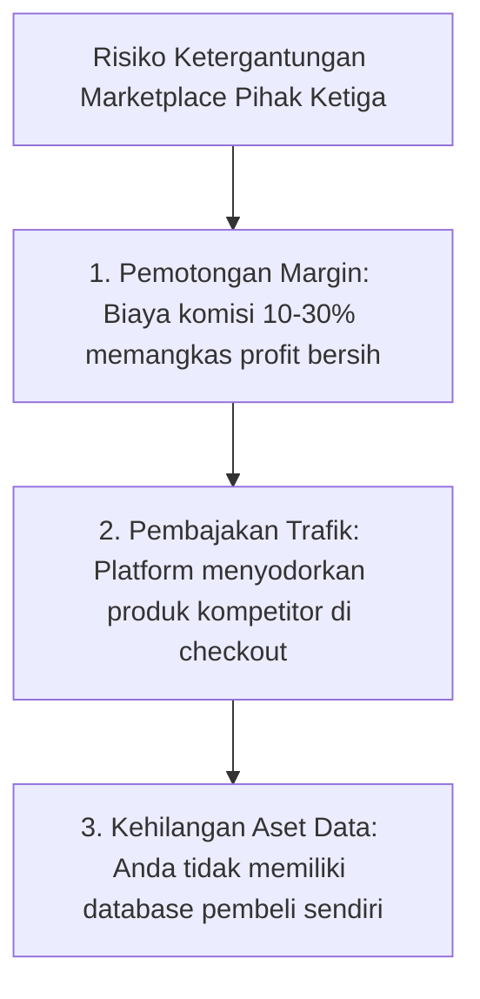
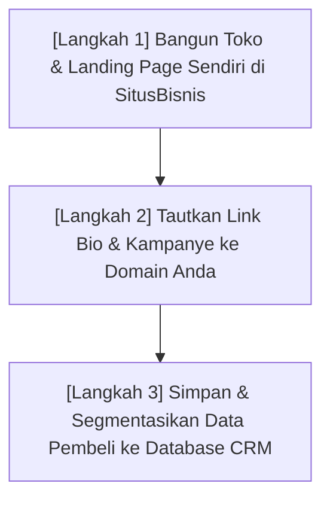

Dalam beberapa tahun terakhir, gelombang kreator konten, penulis, desainer, dan praktisi ahli di Indonesia yang menjual produk digital mengalami lonjakan luar biasa.

Namun, di balik kegembiraan menghasilkan penjualan dari internet, ada satu fenomena yang mulai meresahkan banyak pengusaha digital: **semakin besar omzet mereka, semakin besar pula potongan biaya (*take rate*) yang disedot oleh platform marketplace pihak ketiga.**

Sebagian platform memotong 10%, 15%, bahkan hingga 30% dari setiap transaksi yang terjadi—di luar biaya penarikan dana dan pajak. Yang lebih mencemaskan: **Anda sebagai pemilik produk tidak diberikan akses ke data email dan nomor kontak pembeli Anda sendiri.**

Fenomena ini mendorong lahirnya gerakan **Zero-Commission Commerce (Perdagangan Bebas Komisi)**—sebuah pergeseran paradigma di mana kreator mandiri memilih membangun toko digital berdaulat di bawah kendali penuh mereka sendiri.

---

## 1. Tiga Bahaya Ketergantungan pada Marketplace Pihak Ketiga

Menaruh seluruh masa depan bisnis Anda di atas lahan sewa milik platform raksasa menyimpan risiko sistemik:

### 1. Erosi Margin Laba Bersih
Jika bisnis digital Anda menghasilkan omzet Rp 50.000.000 per bulan:
- Potongan komisi 15% berarti Anda menyetorkan **Rp 7.500.000 setiap bulan** (Rp 90.000.000 per tahun!) hanya untuk biaya transaksi platform.
- Dengan sistem *Zero-Commission* seperti di [SitusBisnis](https://situsbisnis.com), Anda hanya membayar biaya payment gateway riil (seperti biaya QRIS standar Bank Indonesia ~0.7%), sehingga margin laba bersih Anda tetap utuh.

### 2. Algoritma Pembajakan Audiens (Audience Poaching)
Pernahkah Anda membawa ribuan followers dari akun Instagram Anda ke halaman produk di marketplace, lalu tepat di bawah produk Anda muncul rekomendasi: *"Pengguna lain juga melihat produk [Nama Kompetitor] yang lebih murah"*?
Platform marketplace didesain untuk memaksimalkan retensi ekosistem mereka sendiri, bukan untuk melindungi brand Anda.

### 3. Penahanan Data Pelanggan (Hostage Data)
Aset paling bernilai dari sebuah bisnis digital bukanlah produknya hari ini, melainkan **basis data pelanggan yang telah membuktikan daya beli mereka**. Jika suatu hari akun Anda di marketplace dibekukan atau platform mengubah kebijakan sepihak, seluruh hubungan bisnis Anda dengan ribuan pembeli lenyap dalam sekejap.

---

## 2. Perbandingan: Marketplace Terbuka vs. Toko Mandiri Berdaulat

| Dimensi Penilaian | Platform Marketplace Konvensional | Toko Digital Berdaulat (SitusBisnis) |
| :--- | :--- | :--- |
| **Biaya Komisi Platform** | 5% hingga 30% per transaksi | **0% Komisi (Zero-Commission)** |
| **Kepemilikan Data Pembeli** | Disamarkan / Dikunci platform | **100% Milik Anda** (Nama, Email, No. WA diekspor instan) |
| **Kustomisasi Brand & Domain** | Menggunakan subdomain platform yang seragam | Bisa memakai nama brand dan estetika visual eksklusif |
| **Metode Pembayaran Lokal** | Sering kali terbatas / Payout manual mingguan | **QRIS & Virtual Account instan**, dana langsung masuk |
| **Distraksi Iklan Kompetitor** | Sangat banyak rekomendasi produk lain | Bersih 100%, hanya fokus pada penawaran Anda |

---

## 3. Cetak Biru Membangun Ekosistem Bisnis Mandiri

Untuk memindahkan audiens Anda ke toko mandiri tanpa kehilangan momentum penjualan, lakukan transisi 3 langkah ini:

1. **Langkah 1: Siapkan Gerbang Penjualan Mandiri:** Gunakan platform yang menyediakan checkout modern tanpa komisi. Pastikan alur pembayaran mendukung QRIS satu detik dan verifikasi otomatis tanpa perlu kirim bukti transfer WhatsApp secara manual.
2. **Langkah 2: Ambil Kendali Tautan Bio (Link in Bio):** Ganti semua tautan di media sosial (Instagram, TikTok, Twitter, YouTube) agar mengarah langsung ke domain toko digital Anda.
3. **Langkah 3: Bangun Hubungan Langsung Pasca-Pembelian:** Dengan kepemilikan data email dan WhatsApp, Anda dapat menyapa pembeli secara berkala, membagikan update modul materi gratis, dan menawarkan produk lanjutan tanpa harus membayar biaya iklan ulang.

---

## Catatan Penutup

Menjadi kreator mandiri berarti memiliki kedaulatan penuh atas karya, hubungan dengan audiens, dan hasil jerih payah Anda sendiri.

Masa depan perdagangan digital bukan milik mereka yang sekadar menyewa lapak di tanah orang lain, melainkan milik kreator yang berani membangun rumah bisnis mereka sendiri.
