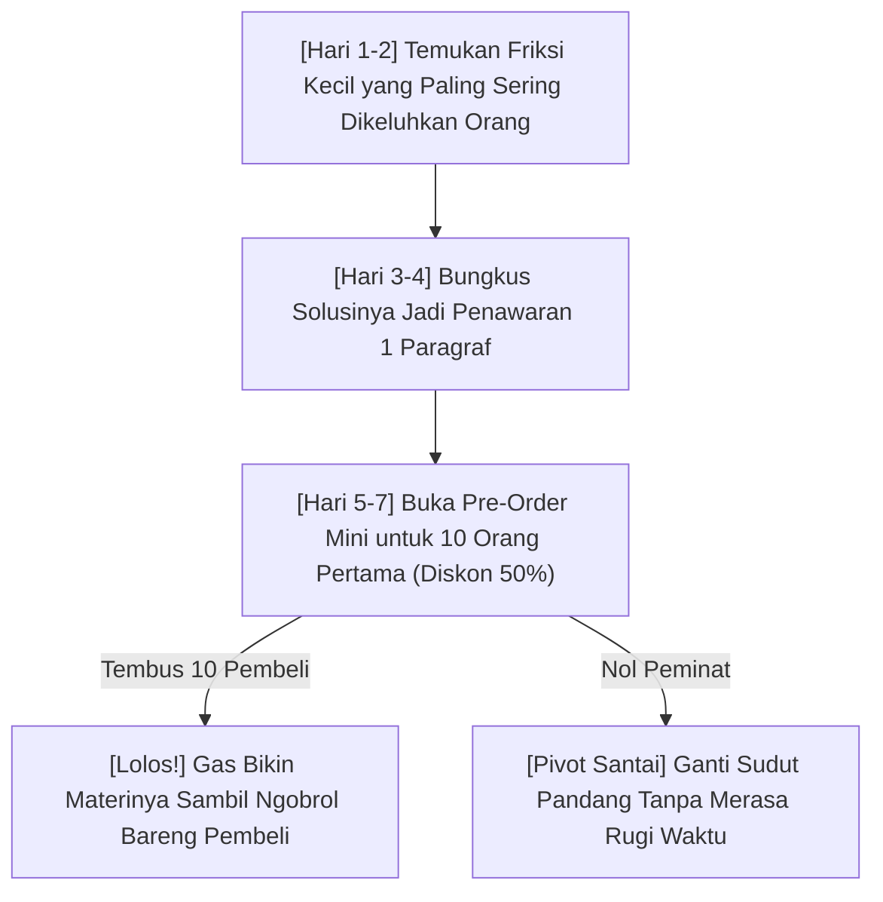

Pernah nggak kamu ngalamin momen ini:
Kamu punya ide cemerlang buat bikin e-book atau kursus online. Saking semangatnya, kamu bela-belain begadang tiap malam selama dua bulan penuh, bikin 60 slide presentasi yang rapi, rekam video puluhan gigabyte, sampai langganan software mahal. 

Tapi pas hari peluncuran tiba... jangkrik berderik. Nggak ada satu pun orang yang beli. 

Jujur, itu rasanya sakit banget. Dan kabar buruknya, **hampir 85% kreator pemula tergelincir di lubang yang sama**. Mereka jatuh cinta pada ide di kepalanya sendiri, tapi lupa mengecek apakah ada orang yang beneran mau bayar buat ide itu.

Makanya, aturan nomor satu kalau kamu mau tembus Rp 50 juta pertamamu adalah: **Haram hukumnya bikin materi lengkap sebelum idemu terbukti menghasilkan uang tunai di muka.**

Di artikel pertama seri ini, kita bakal bongkar cara paling santai dan anti-zonk buat memvalidasi ide produk digital dalam waktu kurang dari 7 hari tanpa keluar modal sepeser pun.

---

## 1. Alur Cepat Menguji Ide Tanpa Bikin Produk Dulu

Biar nggak pusing, ini peta sederhana yang bakal kita ikuti dari nol:

Kalau di tahap pre-order nggak ada yang beli, kamu nggak rugi apa-apa! Kamu cuma kehilangan waktu beberapa hari posting di media sosial, bukan dua bulan begadang bikin materi yang nggak diinginkan pasar.

---

## 2. Cari "Pain Point" yang Bikin Orang Rela Keluar Duit

Kesalahan paling klise pemula adalah mencoba jualan topik yang terlalu abstrak. Contohnya: *"Panduan Menjadi Lebih Produktif"*. 

Jujur aja, siapa yang mau bayar Rp 150 ribu cuma buat kata "produktif"? Nggak ada. Semua orang bisa cari tips produktif gratisan di TikTok atau YouTube.

Orang cuma mau gesek saldo m-banking mereka kalau solusinya **langsung menuntaskan rasa pusing yang spesifik**. Coba perhatikan perbedaannya di tabel ini:

| Ide Umum yang Susah Laku | Ide Spesifik yang Bikin Rebutan | Kenapa yang Kanan Menang? |
| :--- | :--- | :--- |
| Tips Mengatur Keuangan Pribadi | Template Spreadsheet Budgeting Bulanan untuk Pasangan Baru Menikah | Spesifik targetnya, langsung pakai, nggak butuh mikir rumus. |
| Cara Jualan Online Laris | 30 Template Chat WhatsApp Auto-Closing Khusus Olshop Hijab | Menyelesaikan masalah chat yang sering di-read doang sama pembeli. |
| Desain Grafis Komersial | 50 Template Konten Carousel Instagram Siap Edit untuk Agen Properti | Hemat waktu berjam-jam bikin desain dari nol. |

> **Catatan Buat Kamu:**
> Jangan jual "proses belajar". Jual **alat percepatan** atau **jalan pintas** yang bikin hidup pembeli terasa 10x lebih gampang dalam hitungan menit.

---

## 3. Trik Postingan "Pancingan" Tanpa Terlihat Jualan

Gimana cara tahu apakah audiensmu tertarik tanpa harus pasang iklan berbayar? Pakai trik *Hand-Raiser Post* (postingan angkat tangan) di Twitter/X, LinkedIn, atau Threads:

> *"Seminggu terakhir saya merapikan sistem follow-up WhatsApp yang berhasil ningkatin closing rate toko saya dari 12% jadi 38% tanpa admin tambahan.*  
> *Kalau saya bungkus jadi checklist ringkas + template chat-nya, ada yang mau contek? Coba komen 'MAU' ya, nanti saya kirim preview-nya."*

Perhatikan: kamu belum jualan apa-apa. Kamu cuma nanya.
- Kalau yang komen di bawah 3 orang: berarti topiknya kurang menggigit. Ganti sudut pandang lain.
- Kalau yang komen puluhan orang: selamat! Kamu baru saja menemukan tambang emas.

---

## 4. Buka Pre-Order Mini: Validasi Tertinggi Adalah Uang Masuk

Setelah orang-orang komen "MAU", jangan langsung kasih gratisan lengkap. Balas komentar atau DM mereka dengan tawaran eksklusif:

> *"Halo Kak! Materi checklist dan template-nya lagi saya finalisasi biar makin lengkap. Rencananya minggu depan rilis resmi seharga Rp 199.000.*  
> *Tapi khusus untuk 10 orang pertama yang bantu review materi awal, saya buka akses pre-sale cuma Rp 79.000 + bonus konsultasi chat langsung bareng saya.*  
> *Kalau mau amankan slot perdananya, kakak bisa langsung ambil tiketnya di link ini ya: [Link Checkout Tokomu]"*

Kenapa angka 10 orang ini keramat? Karena kalau 10 orang asing rela transfer uang nyata ke rekeningmu buat produk yang bahkan materinya belum kelar 100%, **itu artinya produkmu sudah divalidasi oleh pasar riil**.

---

## Langkah Selanjutnya

Sekarang kamu sudah tahu cara menguji ide produk tanpa risiko dan tanpa modal sepeser pun. 

Di **Bagian 2**, kita bakal bahas: **Gimana caranya mengubah 100 followers pertama jadi pembeli setia yang rela antre menunggu rilis produkmu**—bahkan tanpa kamu harus pusing mikirin algoritma media sosial yang berubah-ubah!
