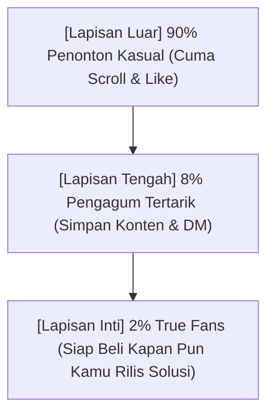
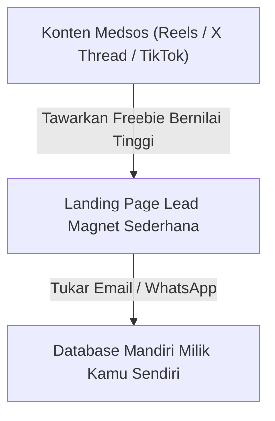

Mitos terbesar yang paling sering menghalangi orang buat mulai jualan produk digital adalah kalimat ini:
> *"Akun saya followers-nya baru 300 orang, mana ada yang mau beli jualan saya? Nanti aja deh kalau followers sudah 10 ribu baru mulai jualan."*

Sadar nggak, kalau kamu terus nunggu sampai followers 10 ribu, kemungkinan besar kamu nggak akan pernah mulai?

Faktanya mengejutkan: **Banyak kreator dengan 500 ribu followers di TikTok yang kesulitan jualan kaos seharga Rp 100 ribu.** Di sisi lain, ada solopreneur yang followers Instagram-nya cuma 800 orang tapi bisa konsisten mengantongi omzet Rp 20 juta per bulan dari template dan konsultasi.

Kuncinya bukan di seberapa banyak orang yang menonton videomu, melainkan **seberapa dalam rasa percaya (*trust*) yang kamu bangun dengan segelintir orang yang tepat**.

Di bagian kedua ini, kita akan bongkar rahasia mengubah pengikut yang sedikit menjadi pasukan pembeli loyal yang nggak sabar nungguin kamu buka jualan.

---

## 1. Piramida Hubungan: Dari Orang Asing Sampai Jadi Pembeli

Jangan anggap semua followers itu sama. Dalam bisnis digital modern, audiensmu terbagi menjadi 3 lapisan:

Kamu nggak butuh jutaan orang di Lapisan Luar. Untuk menghasilkan Rp 50 juta pertamamu, kamu cuma butuh:
- **100 orang di Lapisan Inti** yang membeli produk seharga Rp 500.000, ATAU
- **250 orang** yang membeli paket bundling seharga Rp 200.000!

Cuma itu. Angka 100 sampai 250 orang itu sangat bisa dicapai, bahkan oleh akun kecil yang baru berumur sebulan.

---

## 2. Rumus Konten 3E yang Mengubah Penonton Jadi Fans

Biar followers-mu nggak bosan dan ngerasa kamu cuma mau "menguras dompet mereka", terapkan rotasi konten sederhana ini:

| Tipe Konten | Misi Utama | Contoh Konkret |
| :--- | :--- | :--- |
| **Educate (40%)** | Kasih kemenangan kecil (*quick win*) yang bisa langsung dipraktikkan hari ini. | *"Tutorial 3 menit merapikan database kontak WhatsApp di Excel tanpa rumus rumit."* |
| **Empathize (40%)** | Tunjukkan kamu paham betul penderitaan mereka karena kamu juga pernah di posisi itu. | *"Jujur, tahun lalu saya pernah stres berat gara-gara salah rekrut admin dan rugi belasan juta..."* |
| **Excite (20%)** | Ajak mereka mengintip persiapan produk yang lagi kamu rancang (*behind the scenes*). | *"Lagi nyiapin modul rahasia tentang funnel QRIS, kira-kira format dokumen kerja atau video yang lebih kamu suka?"* |

> **Catatan Buat Kamu:**
> Ketika kamu sering ngajak audiens terlibat dalam proses pembuatan produk (*build in public*), mereka bakal ngerasa ikut memiliki produk tersebut. Saat hari peluncuran tiba, mereka bukan sekadar beli produk, tapi merayakan karya yang mereka ikuti sejak awal!

---

## 3. Pindahkan Followers Medsos ke "Rumah Pribadi"

Media sosial itu tanah sewa. Algoritma Instagram bisa berubah besok pagi, akun TikTok bisa kena shadowban tanpa alasan jelas, dan jangkauan kontenmu bisa anjlok dalam semalam.

Makanya, begitu ada orang yang mulai tertarik dengan kontenmu, **segera pindahkan mereka ke daftar kontak email atau WhatsApp pribadi**:

Dengan punya database kontak sendiri di platform toko mandiri seperti [SitusBisnis](https://situsbisnis.com), kamu bisa menyapa calon pembelimu kapan saja secara gratis tanpa perlu mengemis pada algoritma media sosial.

---

## Rangkuman & Langkah Selanjutnya

Mulai hari ini, stop membandingkan jumlah followers akunmu dengan selebgram papan atas. Fokuslah menyapa 10 sampai 50 orang pertama yang berinteraksi dengan kontenmu, dengarkan keluhan mereka, dan jadikan mereka sahabat diskusimu.

Di **Bagian 3**, kita akan melangkah ke medan tempur utama: **Bongkar rahasia landing page 1 halaman yang bikin pengunjung betah dan langsung pengen klik tombol beli**—lengkap dengan template struktur teksnya yang tinggal kamu tiru!
