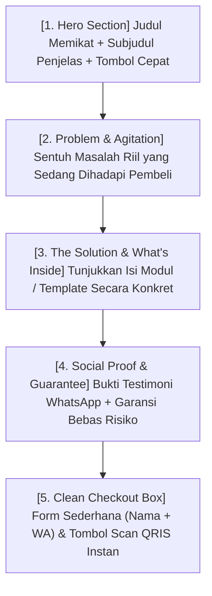

Pernah nggak kamu ngeklik link produk di bio Instagram seseorang, lalu pas kebuka... layarnya lama banget dimuat, animasinya muter-muter bikin pusing, font-nya warna-warni nggak karuan, dan kamu harus scroll panjang cuma buat nyari tahu: *"Ini sebenarnya jualan apa sih?"*

Ujung-ujungnya? Kamu langsung pencet tombol silang (*close tab*) dalam waktu kurang dari 5 detik.

Banyak kreator mengira bikin website jualan itu harus secanggih website korporat raksasa: harus pakai desainer mahal, koding berbulan-bulan, dan efek visual 3D yang berat.

Padahal kenyataannya di lapangan: **Landing page yang paling rajin menghasilkan konversi uang masuk adalah landing page yang sederhana, cepat dibuka di HP, dan langsung to-the-point menjawab kebutuhan pembeli.**

Di artikel ketiga ini, kita bakal membedah anatomi landing page 1 halaman (*single-page sales letter*) yang super simpel tapi terbukti melipatgandakan tingkat pembelian!

---

## 1. Peta 5 Blok Esensial Landing Page Siap Konversi

Lupakan puluhan seksi yang nggak berguna. Sebuah halaman penawaran yang efektif cuma butuh 5 blok yang tersusun rapi dari atas ke bawah:

Mari kita telaah satu per satu cara menuliskannya:

---

## 2. Cara Menulis Masing-Masing Blok Tanpa Basa-Basi

### Blok 1: Hero Section (Penentu 5 Detik Pertama)
Tugas hero section cuma satu: **menghentikan pengunjung agar tidak kabur**.
- **Judul:** Tuliskan hasil impian yang ingin mereka capai.
  > *Contoh:* "Bikin Toko Online Mandiri Siap Terima Pembayaran QRIS dalam 15 Menit Tanpa Sentuh Koding."
- **Subjudul:** Jelaskan siapa produk ini dan apa kemudahannya.
  > *Contoh:* "Panduan praktis dan template siap duplikasi khusus kreator, mentor, dan penjual produk digital yang ingin lepas dari potongan komisi marketplace."
- **Tombol CTA:** *"Amankan Akses Instan Saya Sekarang →"*

### Blok 2: Problem & Agitation (Bikin Pembeli Merasa Dipahami)
Jangan buru-buru jualan fitur. Buat daftar poin penderitaan yang sering mereka rasakan:
- *"Apakah kamu sering capek balas chat manual satu-satu cuma buat kirim no rekening?"*
- *"Pusing lihat omzet jutaan rupiah tapi terpotong belasan persen oleh biaya admin platform?"*
- *"Nggak punya waktu bikin materi dari nol karena sibuk urusan kerjaan harian?"*

Saat membaca ini, kepala calon pembeli akan otomatis mengangguk setuju.

### Blok 3: The Solution (Tunjukkan Barangnya, Jangan Cuma Cerita)
Orang Indonesia sangat visual. Jangan cuma bilang *"Mendapat 5 template keren"*. Tampilkan screenshot asli tampilan dashboard spreadsheet kamu, cover e-book 3D yang elegan, atau cuplikan video dashboard-nya!

Buat daftar checklist yang jelas:
- ✅ **Modul 1:** Cara riset pasar tanpa modal (senilai Rp 150.000)
- ✅ **Modul 2:** Template copywriting siap edit (senilai Rp 200.000)
- ✅ **Bonus:** Akses grup diskusi privat (senilai Rp 300.000)

### Blok 4: Social Proof & Garansi (Hilangkan Rasa Takut Tertipu)
Belanja di internet selalu memicu rasa was-was. Atasi ini dengan:
1. **Screenshot Asli:** Tangkapan layar chat WhatsApp dari pembeli awal yang berterima kasih karena materinya bermanfaat.
2. **Garansi Uang Kembali:** *"Coba pelajari materinya. Kalau dalam 14 hari kamu merasa produk ini nggak ada gunanya buat bisnismu, hubungi kami dan kami kembalikan uangmu 100% tanpa ribet."*

### Blok 5: Checkout Bersih Tanpa Hambatan
Ini rahasia terpenting: **Jangan minta data yang nggak kamu butuhkan!**
Untuk produk digital, kamu cuma butuh:
1. Nama Lengkap
2. Alamat Email (buat kirim link akses)
3. Nomor WhatsApp (buat kirim invoice cadangan)

Nggak perlu minta alamat rumah lengkap, kode pos, atau nomor KTP. Semakin sedikit kolom yang harus diketik calon pembeli, semakin tinggi rasio transaksi yang berhasil lunas!

---

## 3. Matriks Kesalahan Desain Landing Page Pemula

| Hal yang Sering Dilakukan Pemula | Cara Benar yang Terbukti Menghasilkan Uang |
| :--- | :--- |
| Pasang lagu latar otomatis dan animasi pop-up bertumpuk | Desain bersih, hening, dan waktu muat (*load speed*) di bawah 2 detik |
| Menggunakan tombol "Submit" atau "Kirim Pesan" | Menggunakan tombol berorientasi nilai: *"Ya, Berikan Saya Akses Instan!"* |
| Memaksa calon pembeli buat akun baru dan verifikasi email rumit | Langsung checkout instan via QRIS di satu halaman yang sama |

> **Catatan Buat Kamu:**
> Dengan menggunakan platform seperti [SitusBisnis](https://situsbisnis.com), seluruh tata letak landing page mobile-first dan formulir checkout QRIS ini sudah tersedia siap pakai. Kamu tinggal fokus isi teks penawaranmu tanpa perlu menyewa programmer mahal.

---

## Rangkuman & Langkah Selanjutnya

Landing page yang menghasilkan uang bukanlah yang paling ramai hiasannya, melainkan yang paling jernih menyampaikan pesan dan paling mulus proses pembayarannya.

Di **Bagian 4**, kita bakal menyambungkan landing page ini ke mesin transaksi otomatis: **Cara bikin sistem WhatsApp otomatis biar pembeli langsung bayar tanpa kamu perlu begadang membalas chat!**
