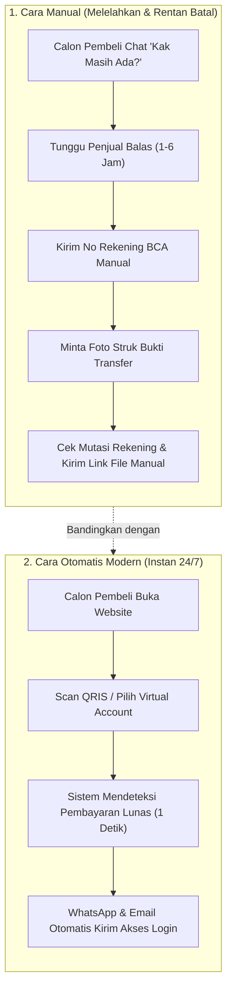

Bayangkan skenario ini:
Hari Minggu jam 11 malam, kamu lagi santai nonton film bareng keluarga atau udah tidur pulas. Tiba-tiba ada notifikasi pesan masuk dari calon pembeli yang tertarik mau beli produk digitalmu.

Kalau kamu masih jualan pakai cara konvensional:
1. Kamu baru balas chat-nya besok pagi jam 8.
2. Si calon pembeli udah nggak mood atau uangnya udah terpakai buat keperluan lain.
3. Begitu kamu kirim nomor rekening, pembeli bilang *"Oke kak nanti ditransfer ya"*, lalu menghilang selamanya (*ghosting*).

Friksi transfer manual dan keterlambatan membalas chat adalah **pembunuh nomor satu penjualan produk digital di Indonesia**. 

Ketika seseorang memutuskan mau beli produk digital, mereka ingin kepuasan instan (*instant gratification*): bayar detik ini, akses terbuka detik ini juga.

Di artikel keempat ini, kita akan merakit sistem **WhatsApp Closing Otomatis**—sebuah mesin yang melayani calon pembeli 24 jam nonstop tanpa kamu harus memegang HP setiap menit.

---

## 1. Perbedaan Fatal: Jualan Manual vs Mesin Otomasi

Coba bandingkan pengalaman calon pembeli di dua toko digital ini:

Di skenario kedua, seluruh proses selesai dalam waktu kurang dari 60 detik. Kamu bisa sedang tidur, berlibur, atau nongkrong di kafe, dan mesin tokomu tetap menghasilkan omzet tanpa jeda!

---

## 2. Tiga Pesan WhatsApp Otomatis yang Wajib Kamu Pasang

Sistem yang cerdas nggak boleh mengirim spam sembarangan. Pesan WhatsApp harus terpicu secara otomatis berdasarkan aksi yang dilakukan pembeli:

### 1. Pesan Pengiriman Akses & Terima Kasih (Detik ke-0)
Begitu pembeli sukses scan QRIS, sistem langsung menyapa mereka di WhatsApp secara personal:
> *"Hai Kak [Nama], terima kasih banyak sudah order [Nama Produk]! Pembayaranmu via QRIS sudah kami verifikasi otomatis.*  
> *Link akses member area dan file materi sudah aktif dan bisa langsung kakak buka di sini: [Link Akses].*  
> *Simpan nomor WhatsApp ini ya kalau sewaktu-waktu kakak butuh bantuan teknis. Selamat belajar dan sukses selalu!"*

### 2. Pesan Penyelamat Invoice Gantung (Jam ke-1)
Sekitar 30% calon pembeli biasanya terhenti di halaman invoice karena terdistraksi (misal: kuota habis, ada kurir paket datang, atau m-banking lagi error).
Satu jam kemudian, sistem mengirimkan pengingat ramah:
> *"Halo Kak [Nama], sekadar info singkat kalau invoice pesanan [Nama Produk] masih tersimpan rapi.*  
> *Biar nggak repot ketik ulang, kakak bisa langsung lanjut pembayaran via QRIS / VA di link ini ya: [Link Invoice]. Semoga harimu menyenangkan!"*

Pesan sederhana ini saja terbukti **menyelamatkan 25% hingga 40% transaksi yang tadinya hampir gagal!**

### 3. Pesan Batas Waktu Terakhir (Jam ke-20)
Empat jam sebelum kode pembayaran hangus:
> *"Halo Kak [Nama], invoice pendaftaran untuk paket promo [Nama Produk] akan ditutup otomatis oleh sistem dalam 4 jam ke depan ya.*  
> *Apakah tadi sempat ada kendala saat pembayaran? Balas chat ini kalau kakak butuh bantuan tim kami ya."*

---

## 3. Rahasia Integrasi Tanpa Pusing Koding

Banyak orang mengira memasang sistem QRIS otomatis dan WhatsApp webhook itu butuh kemampuan programming tingkat dewa.

Dulu mungkin iya. Tapi sekarang, dengan menggunakan platform seperti [SitusBisnis](https://situsbisnis.com):
- Integrasi QRIS dan Virtual Account seluruh bank nasional sudah **langsung aktif tanpa kamu perlu urus izin payment gateway sendiri**.
- Notifikasi status pesanan langsung terhubung secara otomatis ke sistem pengiriman email dan webhook pesan instan.
- Kamu tidak dipotong biaya komisi persenan yang mencekik (100% margin keuntungan penjualan produkmu masuk ke kantongmu sendiri).

---

## Rangkuman & Langkah Selanjutnya

Membangun bisnis digital mandiri bukan tentang bekerja lebih keras dan lembur tiap malam membalas chat. Ini tentang membangun sistem cerdas yang bekerja untukmu.

Di **Bagian 5 (Episode Terakhir)**, kita bakal membongkar jurus pamungkas: **Trik menaikkan omzet 3 kali lipat hanya dengan menambahkan satu kotak kecil saat calon pembeli mau klik bayar!**
