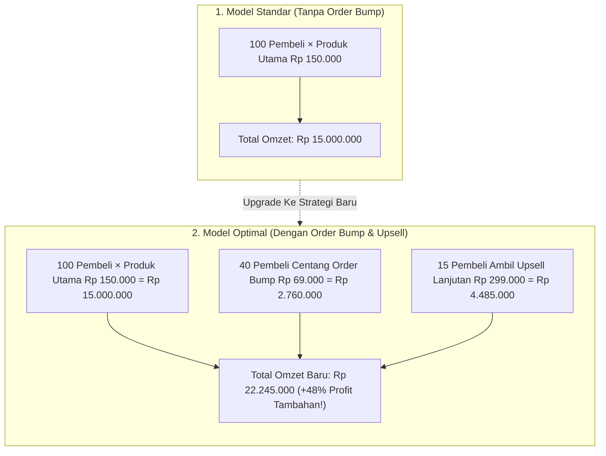

Pernah nggak kamu pergi ke kasir restoran cepat saji, pesan satu porsi ayam goreng, lalu si kasir dengan ramah tersenyum dan bertanya:
> *"Mau sekalian tambah kentang goreng dan es krim cokelatnya kak? Cuma nambah Rp 9.000 aja kok."*

Tanpa pikir panjang, kamu langsung jawab: *"Boleh deh, sekalian."*

Sadar nggak, strategi kasir tadi adalah salah satu rahasia bisnis paling menguntungkan di dunia. Mereka tidak perlu mengeluarkan biaya iklan tambahan untuk mendatangkan pelanggan baru, tapi nilai belanjaanmu seketika melonjak 30% hingga 50%!

Dalam dunia penjualan produk digital, strategi ini dikenal sebagai **Order Bump**—sebuah kotak penawaran kecil dengan satu centang (*one-click checkbox*) yang muncul tepat sebelum calon pembeli menekan tombol bayar QRIS.

Di episode penutup seri *Dari 0 ke Rp 50 Juta Jualan Produk Digital* ini, kita akan membedah cara meracik Order Bump dan Upsell yang bikin omzet tokomu melesat 3 kali lipat dari pembeli yang sama!

---

## 1. Matematika Sederhana: Kekuatan Order Bump di Toko Digital

Mari kita lihat simulasi angka nyata jika tokomu kedatangan 100 pembeli per bulan:



Perhatikan: **Jumlah pembeli barunya sama persis (100 orang), tapi uang yang masuk ke rekeningmu bertambah jutaan rupiah.**

Dan karena produk digital tidak membutuhkan biaya cetak, ongkos kirim, atau biaya gudang, hampir 100% dari tambahan omzet tersebut adalah **laba bersih murni** milikmu!

---

## 2. Tiga Kriteria Penawaran Order Bump yang Sulit Ditolak

Jangan asal taruh produk di kotak Order Bump. Penawaran mini ini harus memenuhi 3 syarat psikologis:

| Kriteria Wajib | Penjelasan Praktis | Contoh Konkret |
| :--- | :--- | :--- |
| **1. Harganya 'No-Brainer'** | Maksimal 30% – 50% dari harga produk utama, sehingga pembeli tidak perlu mikir dua kali. | Produk utama Rp 149.000 → Order bump Rp 49.000. |
| **2. Percepatan Hasil (*Speed*)** | Sesuatu yang membuat pembeli bisa menikmati hasil produk utama lebih cepat. | *"Tambah Rp 49.000 untuk dapat 25 Template Siap Pakai biar nggak perlu desain dari nol."* |
| **3. Format Siap Contek** | File ringkas yang tinggal di-copy-paste (seperti checklist, swipe file, atau kumpulan prompt AI). | Kumpulan 50 Prompt ChatGPT untuk Copywriting Landing Page. |

> **Catatan Buat Kamu:**
> Jangan jadikan Order Bump sebagai "kelanjutan materi wajib" yang kalau tidak dibeli bikin produk utamanya jadi cacat. Order bump harus berupa pelengkap yang menyempurnakan, bukan pemerasan terselubung.

---

## 3. Desain Kotak Order Bump yang Memikat Mata

Di halaman checkout tokomu, buat kotak Order Bump dengan tampilan visual yang kontras (misalnya kotak berbingkai garis putus-putus dengan latar belakang kuning/amber lembut):

```
┌──────────────────────────────────────────────────────────┐
│ ☑ YA, TAMBAHKAN ASET TEMPLATE PRO (HEMAT 70%)           │
│                                                          │
│ Cuma tambah Rp 49.000 (Harga normal Rp 199.000).        │
│ Dapatkan 30 file template spreadsheet siap duplikasi    │
│ yang langsung otomatis menghitung laporan keuanganmu.   │
└──────────────────────────────────────────────────────────┘
```

Secara psikologis, saat jari calon pembeli sudah siap bayar, mental mereka sudah berada di mode *"membeli"*. Mencentang satu kotak kecil seharga segelas kopi terasa sangat ringan di kantong mereka!

---

## 4. Peta Lengkap Flywheel Menuju Rp 50 Juta Pertama

Sekarang, gabungkan seluruh 5 bagian yang sudah kita pelajari sejak awal:

1. **Validasi:** Uji masalah nyata dan amankan 10 pembeli pertama tanpa modal (Part 1).
2. **Audiens:** Pindahkan penonton media sosial ke database kontak mandiri milikmu (Part 2).
3. **Landing Page:** Tulis penawaran 1 halaman yang bersih dan to-the-point (Part 3).
4. **Otomasi:** Pasang checkout instan QRIS dan notifikasi WhatsApp 24/7 (Part 4).
5. **Ekspansi Nilai:** Pasang Order Bump dan Upsell bertingkat untuk memaksimalkan omzet (Part 5).

Di platform [SitusBisnis](https://situsbisnis.com), semua infrastruktur ini sudah dirancang terintegrasi dan bisa kamu jalankan secara mandiri tanpa potongan komisi sepeser pun.

---

## Kata Penutup Seri

Menghasilkan Rp 50 juta pertama dari produk digital bukanlah mimpi di awang-awang atau privilese segelintir selebgram viral. Ini adalah hasil dari kombinasi **keberanian memulai, empati memahami masalah audiens, dan sistem penjualan yang rapi**.

Mulailah dari langkah pertama hari ini. Buat tokomu, rilis aset pertamamu, dan buktikan sendiri nikmatnya kebebasan finansial sebagai kreator mandiri!
